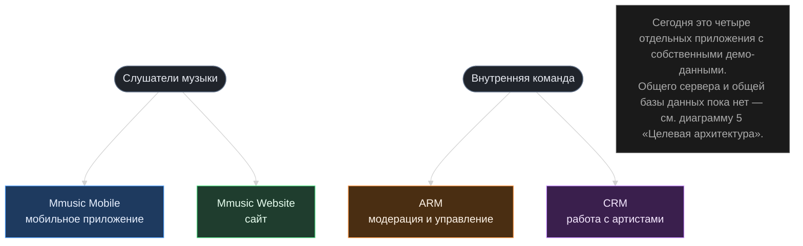

# Диаграмма 0 — обзор для руководства (Executive Overview)

Статус: **ТЕКУЩЕЕ, максимально упрощено**. Это не техническая диаграмма — цель прочитать и понять за 15 секунд, без знания терминов разработки. Детали и версии — в диаграммах 1-4; целевая архитектура — в диаграмме 5.

## Как это читать (для презентации руководству)

- **Слушатели** пользуются двумя приложениями — **Mobile** и **Website** — чтобы слушать музыку и поддерживать артистов донатами.
- **Внутренняя команда** использует два рабочих инструмента — **ARM** (модерация и администрирование) и **CRM** (работа с артистами, группами, организациями и сделками).
- Все четыре приложения выглядят и ведут себя согласованно (общий дизайн), но **технически это четыре независимых продукта**: нет общего сервера, нет общей базы данных, нет единого входа (авторизации). Каждое приложение сегодня работает на собственных демо-данных на устройстве пользователя.
- Что нужно, чтобы это стало одной связанной системой — отдельная диаграмма «Целевая архитектура» (`05-future-architecture.md`), основанная на уже утверждённом техническом задании.
