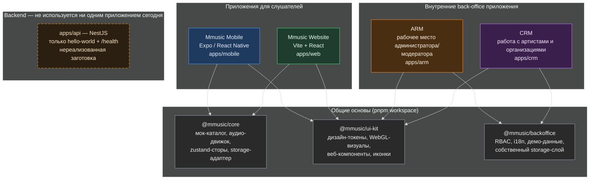

# Диаграмма 1 — обзор экосистемы Mmusic

Высокоуровневая схема всех четырёх приложений и того, что их на самом деле связывает — общие пакеты монорепозитория, а не общий backend.

## Как это читать

- **Mobile и Website** — «пара» потребительских приложений: обе читают один и тот же мок-каталог и аудио-логику из `@mmusic/core`, обе используют `@mmusic/ui-kit`.
- **ARM и CRM** — отдельная «пара» back-office приложений: обе построены на `@mmusic/backoffice` (RBAC, демо-данные), а не на `@mmusic/core`. CRM вообще не импортирует `@mmusic/core` — в коде явно написано «CRM uses no @mmusic/core catalog data».
- **Единственное, что физически связывает все четыре приложения — `@mmusic/ui-kit`** (дизайн-токены и компоненты). Прямой связи между потребительскими и back-office приложениями нет: ни общего API, ни общей базы данных, ни общей сессии пользователя.
- **`apps/api`** существует в репозитории, но на сегодня в него никто не стучится — это задел под будущий backend (см. диаграмму 3).

Подробности по стеку и хранению данных — в диаграмме 2; по тому, что в этой картине запланировано, но не реализовано, — в диаграмме 3.
