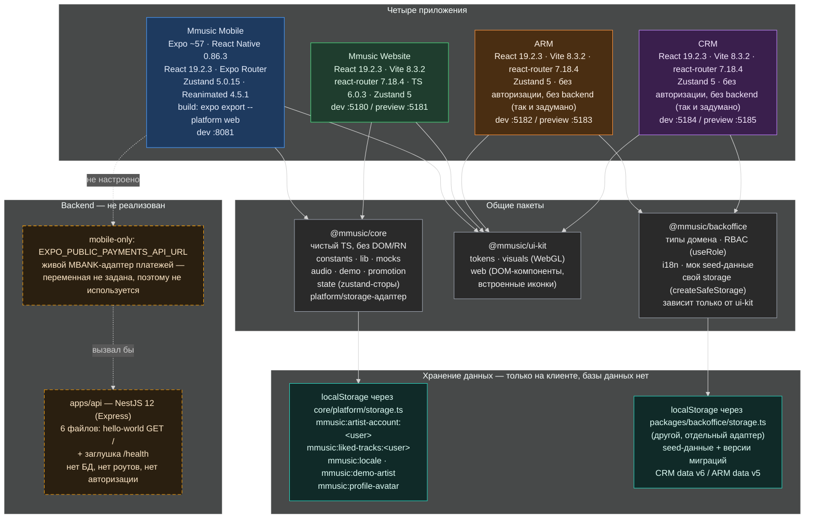

# Диаграмма 2 — техническая архитектура

Стек, точные версии и слой персистентности для каждого приложения — всё подтверждено по `package.json`/`vite.config`/коду, без предположений.

## Заметки

- Все четыре приложения на **одних и тех же версиях** React 19.2.3 / Zustand 5 — стек унифицирован сознательно (см. `restructure-app-ui-kit` в истории проекта).
- **Два независимых storage-слоя**: `core/platform/storage.ts` (mobile+web) и `packages/backoffice/storage.ts` (ARM+CRM) не связаны между собой — у них разные ключи и разная логика адаптера.
- Единственный реальный `fetch()` к внешнему API во всём репозитории — `apps/mobile/src/lib/payments/mbank-payment.ts`, живой адаптер MBANK-платежей, включаемый флагом `EXPO_PUBLIC_MBANK_PAYMENT_MODE=live`. Сегодня этот флаг и `EXPO_PUBLIC_PAYMENTS_API_URL` не заданы, поэтому в проде используется демо-адаптер из `@mmusic/core`.
- `apps/api` (NestJS) — 6 файлов, `GET /` hello-world и заглушка `/health`. Ни БД-клиента, ни бизнес-роутов нет.
