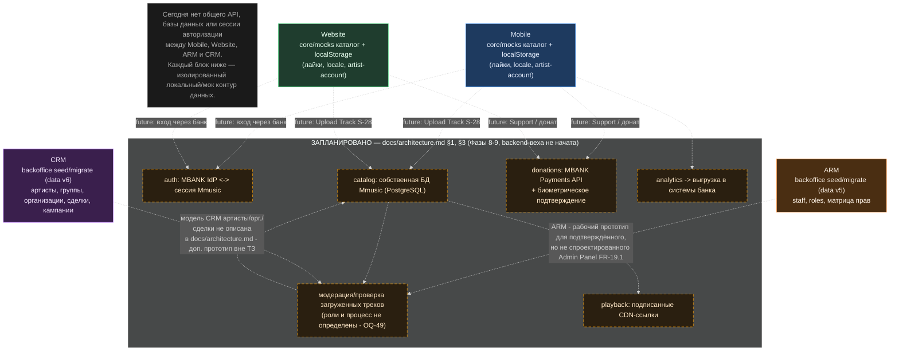

# Диаграмма 3 — поток данных: сегодня и по плану

Явно разделяет то, что подтверждено в коде («сегодня»), и то, что только задокументировано в `docs/architecture.md` как цель backend-вехи, которая ещё не начата.

## Что это означает

**Реально движется сегодня:** внутри каждого приложения — из мок-данных в состояние (zustand) и обратно в `localStorage`. Между приложениями данные не движутся вообще: трек, опубликованный в демо-кабинете артиста на мобильном, не появляется ни в CRM, ни в ARM; роль, выданная в ARM, не видна в CRM; ничего из CRM не попадает в каталог Mobile/Website.

**Запланировано (по `docs/architecture.md` §1/§3/§5, `docs/technical-specification.md` §3.19), но не реализовано:**
- `auth` — обмен токена MBANK на сессию Mmusic;
- `catalog` — собственная БД Mmusic, наполняется через Upload Track (S-28) и будущую Admin Panel;
- модерация загруженных треков — роль и процесс явно не определены (**OQ-49**);
- `playback` — отдача аудио через CDN по подписанным URL;
- `donations` — донат через MBANK Payments API с биометрическим подтверждением; вопрос комиссии платформы не решён (**OQ-10**);
- `analytics` — выгрузка событий в системы банка.

**Важный пробел для обсуждения:** в ТЗ подтверждён, но не спроектирован модуль **Admin Panel** (FR-19.1, роли/права — **OQ-54**). ARM выглядит как рабочий прототип именно этого модуля. А вот модель данных CRM (артисты как юрлица, группы, организации, сделки) **не описана ни в одном утверждённом документе** — это самостоятельная инициатива, которую стоит явно сверить с product-владельцем перед тем, как на неё опирается дальнейшая архитектура.
