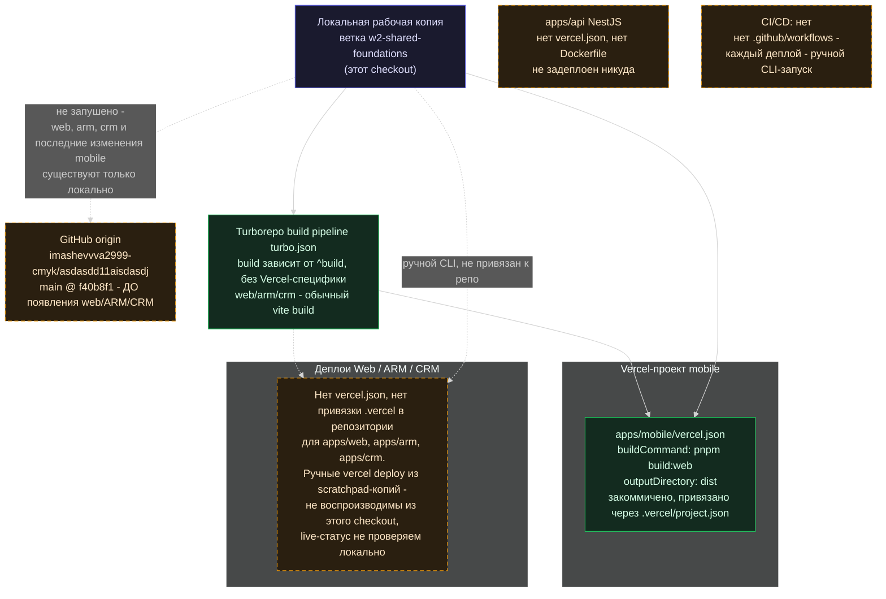

# Диаграмма 4 — архитектура деплоя

Основано только на локальных файлах: `.vercel/project.json`, `apps/mobile/vercel.json`, `turbo.json`, `git remote -v`, `git ls-remote`. Всё, что нельзя проверить по файлам репозитория, явно помечено.

## Заметки

- **Только `apps/mobile` имеет закоммиченную конфигурацию деплоя** (`apps/mobile/vercel.json` + `.vercel/project.json`, имя проекта «mobile»; ID проекта и команды Vercel — в локальном `.vercel/project.json`, который не хранится в git). Корневой `.vercel/project.json` указывает на тот же проект «mobile», а не на отдельный корневой проект.
- **У web/arm/crm нет ни `vercel.json`, ни привязки `.vercel`** в этом репозитории. Упомянутые в прошлых сессиях адреса вида `mmusic-web.vercel.app` / `mmusic-arm.vercel.app` / `mmusic-crm.vercel.app` нигде не встречаются ни в `docs/`, ни в README — это результат ручных `vercel deploy` из временных копий, а не часть репозитория. Их текущий live-статус **не проверяем локально**.
- **Git remote существует**, но сильно отстаёт: `origin/main` = `f40b8f1` — коммит **до** появления `apps/web`, `apps/arm`, `apps/crm`. Всё, что показано на диаграммах 1-3, существует только в локальной рабочей копии на ветке `w2-shared-foundations`. Потеря этой папки = потеря всей текущей работы по web/ARM/CRM.
- **CI/CD отсутствует полностью** — нет `.github/workflows`. Все деплои до сих пор делались вручную через Vercel CLI.
- `apps/api` не имеет никакой конфигурации деплоя (ни `vercel.json`, ни `Dockerfile`) — задел под backend существует только локально и нигде не запущен.
