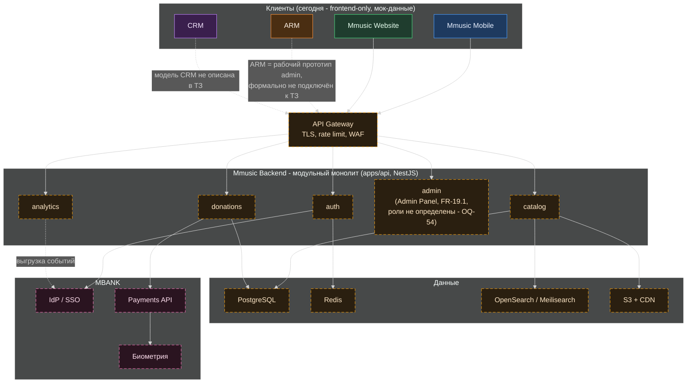

# Диаграмма 5 — целевая архитектура (TO-BE)

Статус: **ЦЕЛЕВОЕ / ПЛАНИРУЕМОЕ — ничего из этого не реализовано.** Основано на уже утверждённых разделах технического задания: `docs/architecture.md` §1 («Общая архитектура»), §3 («Backend»), §5 («Поток данных»), §6 («Модели данных»); `docs/technical-specification.md` §3.19 («Admin Panel»). Это не предложение этого анализа — это существующий, ранее одобренный лидом продукта план, реализация которого отложена до отдельного одобрения backend-вехи (Фазы 8-9 в `docs/development-plan.md`).

## Как это читать

- **Клиенты** — те же 4 приложения, что и сегодня, но обращаются к единому **API Gateway** вместо локальных мок-данных.
- **Backend** — модульный монолит на NestJS (задел `apps/api` уже существует, но пуст): модули `auth`, `catalog`, `donations`, `admin`, `analytics` и другие (`users`, `search`, `library`, `playlists`, `playback`, `recommendations` — см. `docs/architecture.md` §3.2).
- **Данные**: собственная БД Mmusic на PostgreSQL (каталог — не обёртка над внешним сервисом, подтверждено 2026-10-06), Redis для кеша/сессий, поиск через OpenSearch/Meilisearch, аудио и обложки через S3+CDN.
- **MBANK** — банк предоставляет IdP/SSO для входа, Payments API + биометрию для донатов; Mmusic никогда не хранит платёжные данные сам.
- **Пунктирные розовые связи с MBANK** и **пунктирные жёлтые узлы backend/данных** — всё это **не реализовано**, это цель, не факт.
- **ARM и CRM подключены пунктиром с пояснением**, потому что в одобренном ТЗ есть только модуль `admin` (Admin Panel, FR-19.1) без определённых ролей (OQ-54) — ARM выглядит как его рабочий прототип. Модель данных CRM (артисты/группы/организации/сделки) в этом ТЗ вообще не описана; это самостоятельная инициатива, которую стоит официально сверить с продуктом, прежде чем встраивать в этот план.
- Важное решение лида продукта (2026-10-07), зафиксированное в документах: вся эта архитектура остаётся целевой и **не отменяется** — её реализация просто отложена до отдельного одобрения backend-вехи; текущая фаза — frontend only, на мок-данных.
