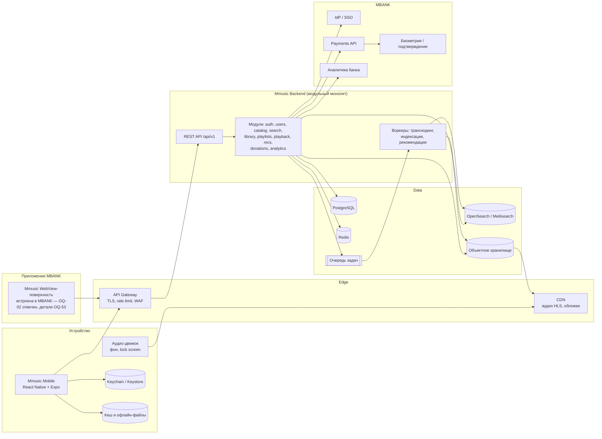
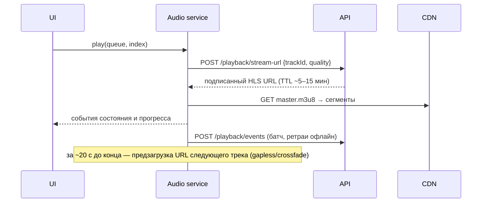
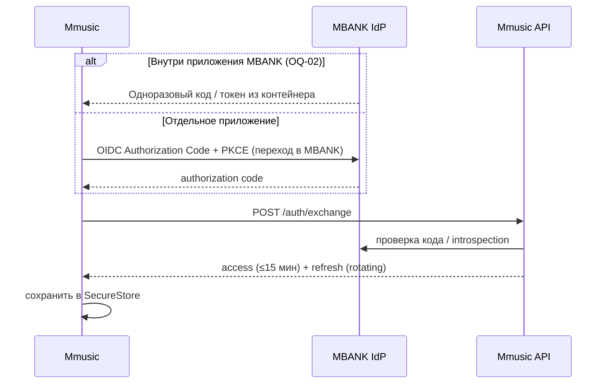
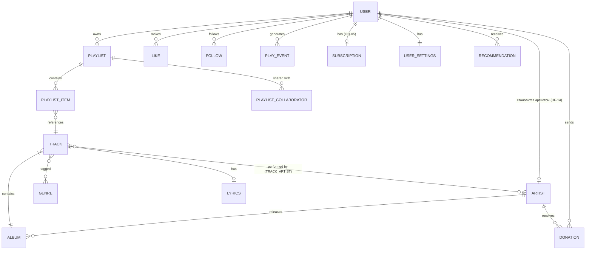

# Архитектура — Mmusic

> Разделы 9–11 ТЗ. Весь документ — **предложение [П]**. Выбор стека зависит от ответов на **OQ-03** (ОС/формфакторы), **OQ-36** (инфраструктура банка), **OQ-44** (существующие API банка), **OQ-53** (технические детали WebView-интеграции).
> **Решение лида продукта 2026-10-06:** платформа — **обе**, мобильное приложение **и** WebView-интеграция внутри MBANK (OQ-02 отвечен, см. `docs/open-questions.md` §H); каталог — собственная БД Mmusic, не внешний провайдер; Admin Panel подтверждена как требование (скоуп — OQ-54, не реализуется сейчас); донаты в первой версии — KGS.
> **Решение лида продукта о порядке работ, 2026-10-07:** текущая веха разработки — **Frontend only**. Эта архитектура (включая `apps/api`, PostgreSQL, Redis, модули §3.2, схему данных §6) остаётся целевой и **не отменяется** — её реализация отложена до отдельного одобрения Backend-вехи (`docs/development-plan.md`, Фазы 8–9). Backend-скелет из Фазы 1 (`apps/api`, NestJS, `GET /health`) уже существует в репозитории и не трогается до этого одобрения. Frontend (Фазы 2–7, A) строится на мок/локальных данных за интерфейсами, совместимыми с этой архитектурой.

## 1. Общая архитектура



**Принципы:** клиент тонкий, бизнес-логика на сервере; аудио отдаётся только через CDN по подписанным URL; Mmusic **никогда** не хранит платёжные данные и не списывает деньги сам — только инициирует операцию через API банка.

## 2. Frontend

### 2.1 Рекомендуемый стек
| Технология | Зачем | Почему |
|---|---|---|
| **React Native + Expo (SDK последней стабильной версии), TypeScript** | Одна кодовая база iOS + Android | Дизайн мобильный (390pt); быстрая разработка; Expo поддерживает встраивание в существующее нативное приложение (brownfield), если ответ на OQ-02 — «модуль внутри MBANK» |
| **Expo Router** | Файловая навигация, табы, стеки, модалки, deep links | Совпадает со структурой дизайна (3 таба + вложенные стеки + шторки) |
| **react-native-track-player** | Воспроизведение, очередь, фон, lock screen, гарнитура | Зрелое решение для музыкальных плееров; HLS; события прогресса |
| **TanStack Query** | Серверное состояние, кеш, оптимистичные лайки | Стандарт для REST-клиентов, офлайн-кеш |
| **Zustand** | Локальное состояние (UI плеера, настройки) | Простое, без бойлерплейта |
| **react-native-reanimated + gesture-handler** | Шторки, свайпы, drag в очереди, анимация эквалайзера | 60 fps на UI-потоке |
| **@gorhom/bottom-sheet** | Все bottom sheets из дизайна | Готовые жесты и blur-фон |
| **expo-blur, expo-linear-gradient** | Glassmorphism, градиенты hero | Требование DESIGN.md |
| **expo-image** | Кеширование обложек, плейсхолдеры | Производительность лент |
| **react-native-mmkv** | Быстрое локальное хранилище (настройки, недавние поиски) | Синхронный и быстрый доступ |
| **expo-secure-store** | Токены | Keychain / Keystore |
| **expo-local-authentication** | Локальная биометрия (если банк не даёт свой SDK) | OQ-15 |
| **Jest + React Native Testing Library, Maestro** | Unit/компонентные и E2E-тесты | Стабильные E2E для мобильных |

**Вторая поверхность — WebView внутри MBANK [П, требование подтверждено 2026-10-06, OQ-02]:**
Mmusic нужен не только как отдельное мобильное приложение, но и как встроенная в MBANK WebView-поверхность — это подтверждённое решение лида продукта, не альтернатива. Известное ограничение: внутри WebView фоновое аудио и lock-screen-контролы ограничены или недоступны (ядро продукта для полноценного приложения) — это принимается как ограничение именно этой поверхности, а не причина её не делать. Технические детали (объём функций в WebView, чем встраивание отличается от полного приложения, передача сессии) — **OQ-53**.

**Альтернативы (если так решит банк):**
- (a) нативные Swift/Kotlin — если банк требует только нативный код в своём приложении.

### 2.2 Архитектура клиента
- **Слои:** `app/` (маршруты, экраны) → `features/` (логика фич) → `components/` (UI-кит по дизайн-системе) → `services/` (API-клиент, аудио, хранилище) → `theme/` (токены).
- **Плеер — синглтон-сервис** (`services/audio`) поверх track-player. UI (мини-плеер, полный плеер, lyrics, очередь) подписан на один стор `playerStore`.
- **API-клиент генерируется из OpenAPI** (`packages/shared`): типы клиента и сервера всегда совпадают.
- **Дизайн-токены** — из DESIGN.md в `packages/design-tokens` (единый источник для приложения).

## 3. Backend

### 3.1 Стек
| Технология | Почему |
|---|---|
| **Node.js LTS + NestJS (TypeScript)** | Модульность из коробки, DI, OpenAPI-генерация; один язык с клиентом |
| **PostgreSQL** | Реляционные связи каталога, плейлистов, платежей; транзакции |
| **Prisma** или **Drizzle** ORM | Типобезопасные запросы и миграции |
| **Redis** | Кеш каталога, rate limit, сессии, счётчики прослушиваний |
| **OpenSearch** (или Meilisearch для MVP) | Поиск с опечатками, морфологией, кириллицей и латиницей |
| **S3-совместимое хранилище** (в контуре банка или облаке — OQ-36) + **CDN** | Аудио и изображения |
| **FFmpeg-воркеры + очередь (BullMQ)** | Транскодинг в HLS (AAC + lossless), нормализация громкости (LUFS) |
| **OpenTelemetry + Prometheus/Grafana** | Наблюдаемость |

[П] Начинаем с **модульного монолита**; модули с независимой нагрузкой (стриминг-токены, поиск, рекомендации) можно позже выделить в сервисы.

### 3.2 Модули (основные сервисы)
| Модуль | Ответственность |
|---|---|
| `auth` | Обмен токена банка на сессию Mmusic, refresh, logout |
| `users` | Профиль, аватар, настройки, статистика «Listening Pulse» |
| `catalog` | Артисты, альбомы, треки, жанры, редакционные плейлисты, тексты песен. **Собственная БД Mmusic (подтверждено 2026-10-06)** — не обёртка над внешним стриминговым каталогом; пополняется через будущую Admin Panel и загрузку треков артистами (Artist Flow) |
| `search` | Индексация, поиск, недавние и трендовые запросы |
| `library` | Лайки, сохранения, подписки (Follow) |
| `playlists` | CRUD, порядок треков, публичность, коллабораторы |
| `playback` | Выдача подписанных URL на стрим, события воспроизведения, «Jump Back In» |
| `recommendations` | For you, миксы настроений, похожие артисты, autoplay |
| `donations` | Суммы, создание платежа через банк, статусы, история, квитанции |
| `analytics` | Сбор событий и выгрузка в систему банка |
| `admin` | **Подтверждено как требование продукта 2026-10-06** — управление каталогом/контентом Mmusic. Детальный скоуп, роли и права **не определены** (OQ-54) и **не реализуются в текущей фазе**; модуль заложен на будущее |

## 4. Структура API (REST, `/api/v1`)

| Ресурс | Методы |
|---|---|
| Auth | `POST /auth/exchange` (токен банка → сессия), `POST /auth/refresh`, `POST /auth/logout` |
| Me | `GET/PATCH /me`, `PUT /me/avatar`, `GET/PATCH /me/settings`, `GET /me/stats` |
| Home | `GET /home` (секции For you, Featured, Trending, New Releases, Jump Back In, Mixes) |
| Browse | `GET /browse/genres`, `GET /genres/{id}`, `GET /releases?filter=this_week\|charts\|albums\|singles` |
| Catalog | `GET /artists/{id}`, `GET /artists/{id}/top-tracks`, `GET /artists/{id}/releases`, `GET /artists/{id}/related`, `GET /albums/{id}`, `GET /tracks/{id}`, `GET /tracks/{id}/lyrics` |
| Search | `GET /search?q=&type=all\|track\|artist\|album\|playlist`, `GET /search/trending`, `GET/DELETE /me/search-history` |
| Library | `GET /me/library?filter=&sort=`, `PUT/DELETE /me/likes/tracks/{id}`, `PUT/DELETE /me/saved/{albums\|playlists\|genres}/{id}`, `PUT/DELETE /me/following/artists/{id}` |
| Playlists | `POST /playlists`, `GET/PATCH/DELETE /playlists/{id}`, `POST /playlists/{id}/tracks`, `DELETE /playlists/{id}/tracks/{itemId}`, `PATCH /playlists/{id}/tracks/order` |
| Playback | `POST /playback/stream-url` (trackId, quality) → подписанный URL; `POST /playback/events` (батч play/skip/complete); `GET /me/recently-played` |
| Recs | `GET /recommendations/mixes`, `GET /recommendations/autoplay?seedTrackId=` |
| Donations | `GET /donations/presets`, `GET /me/payment-accounts`, `POST /donations` (Idempotency-Key), `GET /donations/{id}`, `GET /me/donations?filter=`, `GET /donations/{id}/receipt` |

Соглашения: курсорная пагинация (`?cursor=&limit=`), ошибки в формате RFC 7807, `ETag` для каталога, заголовок `Idempotency-Key` обязателен для `POST /donations`.

## 5. Поток данных

### 5.1 Воспроизведение

- Качество выбирается по настройкам (Wi-Fi / сотовая сеть / Lossless) [Д S-24].
- Нормализация громкости — по LUFS-метаданным, рассчитанным при транскодинге.
- Офлайн (если в скоупе, OQ-21): зашифрованные файлы, лицензия с TTL, периодическая проверка онлайн.

### 5.2 Аутентификация


### 5.3 Донат
Клиент → `POST /donations` с Idempotency-Key → модуль `donations` создаёт запись `pending` → вызывает Payments API банка → банк подтверждает операцию у пользователя (биометрия) → webhook или polling → `completed` / `failed` → клиент показывает S-21 или ошибку. Повтор с тем же ключом возвращает тот же результат. Все переходы статусов пишутся в аудит-лог.

**Комиссия [Т, OQ-10 — не решено]:** ни диаграмма, ни API-ресурс `Donations` (раздел 4) не содержат логики удержания комиссии — вся сумма идёт по флоу как есть. Это не означает подтверждённую бизнес-модель «0% комиссии»: модель комиссии не решена лидом продукта и требует отдельного анализа перед реализацией (см. `docs/open-questions.md` OQ-10). Логика расчёта/удержания комиссии не реализуется, пока вопрос не закрыт.

## 6. Модели данных (раздел 10 ТЗ)



| Сущность | Ключевые поля | Источник |
|---|---|---|
| **User** | id, bankCustomerRef (хеш внешнего ID), username, displayName, avatarUrl, memberSince, vipStatus, locale | [Д S-23] |
| **UserSettings** | streamingQualityWifi, streamingQualityCellular, lossless, spatialAudio, normalization, downloadQuality, downloadOverCellular, crossfadeSec (0–12), gapless, eqPreset, autoplay, receiptsDigestEmail | [Д S-24, S-17] |
| **Artist** | id, **ownerUserId** (1:1 на User, см. UF-14 — пользователь становится артистом из своего профиля), name, verified, photoUrl, bio, location, genres[], monthlyListeners, payoutAccountRef (шаг привязки не задизайнен — OQ-48), supportEnabled | [Д S-08, S-26] |
| **Album** | id, title, type (album / ep / single), artistId, releaseDate, coverUrl, label, copyright, trackCount, durationSec | [Д S-09] |
| **Track** | id, title, albumId, trackNo, durationSec, explicit, isLossless, audioMaster, isrc, playCount, hlsPath, loudnessLufs. **Поля для самостоятельной публикации артистом (статус загрузки/транскодирования, черновик, дата релиза по расписанию) пока не добавлены** — состояния не определены дизайном, см. OQ-50 | [Д S-09, S-11, S-28] |
| **TrackArtist** | trackId, artistId, role (main / feat) | [Д «feat.»] |
| **Genre** | id, title, category (genre / mood / regional), subtitle, imageUrl, monthlyListeners | [Д S-06, S-07] |
| **Lyrics** | trackId, lines[{timeMs, text}], synced, source (OQ-23) | [Д S-16] |
| **Playlist** | id, ownerId \| editorial, title (≤ 50), description, coverUrl / coverStyle, isPublic, isCollaborative, likesCount, updatedAt | [Д S-14, S-11] |
| **PlaylistItem** | id, playlistId, trackId, position, addedBy, addedAt | [Д S-18] |
| **Like / Favorite** | userId, entityType (track / album / playlist / genre), entityId, createdAt | [Д ♥, bookmark] |
| **Follow** | userId, artistId, createdAt | [Д Following] |
| **PlayEvent / Recently Played** | userId, trackId, contextType / contextId, startedAt, playedMs, completed, skipped | [Д Jump Back In, Listening Pulse] |
| **SearchHistory** | userId, query, createdAt | [Д Recent Searches] |
| **Donation** | id, userId, artistId, amount (minor units), currency (KGS — **подтверждено для первой версии 2026-10-06**, не обязательно единственная валюта навсегда), accountMask, note?, isNotePublic?, status (pending / completed / failed / refunded), bankTxnId, idempotencyKey, createdAt, completedAt. **Полей для комиссии платформы нет** — модель комиссии не решена (OQ-10) | [Д S-19…S-22] |
| **Subscription** | userId, plan, status, startedAt, renewsAt, paymentMethodRef | **[П] — направление Free+Premium подтверждено 2026-10-06, но точная модель (тарифы, лимиты) не определена; схема полей не окончательна (OQ-05)** |
| **Recommendation / Mix** | id, userId?, type (for_you / mood / daily), title, trackIds[], generatedAt, expiresAt | [Д Mixes] |
| **Download** (на устройстве) | trackId, quality, path, licenseExpiresAt | [Д Downloaded], OQ-21 |

Правила: деньги хранятся в целых минорных единицах; все внешние идентификаторы банка — только ссылки и хеши, без персональных данных банка в БД Mmusic [П].

## 7. Структура проекта (раздел 11 ТЗ)

```
Mmusic app/
├── apps/
│   ├── mobile/                  # Expo-приложение
│   │   ├── app/                 # Expo Router: маршруты = экраны
│   │   │   ├── (tabs)/          # home, search, library — таб-бар
│   │   │   ├── artist/[id].tsx  album/[id].tsx  playlist/[id].tsx  genre/[id].tsx
│   │   │   ├── player/          # now-playing, lyrics, queue (модальный стек)
│   │   │   ├── sheets/          # add-to-playlist, track-options, support, confirm
│   │   │   ├── profile/         # profile, settings, support-history
│   │   │   └── _layout.tsx
│   │   ├── src/
│   │   │   ├── components/      # UI-кит: buttons, cards, rows, chips, sheets, player/*
│   │   │   ├── features/        # home, search, library, playlists, player, donations, profile
│   │   │   ├── services/        # api (сгенерированный клиент), audio, storage, auth, analytics
│   │   │   ├── stores/          # zustand: player, ui, settings
│   │   │   ├── theme/           # подключение design-tokens, шрифты
│   │   │   └── utils/
│   │   └── tests/               # unit + компонентные; e2e/ — сценарии Maestro
│   └── api/                     # NestJS backend
│       ├── src/modules/         # auth, users, catalog, search, library, playlists,
│       │                        # playback, recommendations, donations, analytics
│       ├── src/common/          # guards, interceptors, errors (RFC 7807), idempotency
│       ├── prisma/              # схема и миграции
│       └── test/                # unit, integration, e2e
├── packages/
│   ├── shared/                  # OpenAPI-контракт, сгенерированные типы
│   └── design-tokens/           # токены из DESIGN.md (цвета, типографика, радиусы)
├── workers/                     # транскодинг, индексация, рекомендации
├── docs/                        # ТЗ и проектная документация
├── config/                      # общие конфиги (eslint, tsconfig base, env-шаблоны)
├── scripts/                     # служебные скрипты
├── tests/                       # сквозные контрактные / нагрузочные тесты
└── stitch_mmusic_mobile_streaming_app/   # исходный дизайн (не изменяется)
```
[П] Монорепозиторий на pnpm workspaces + Turborepo. Папка с дизайном остаётся на месте как эталон; перенос — только с вашего согласия.

## 8. Безопасность (сводно)
- OWASP MASVS L2 и ASVS L2; требования ИБ банка (OQ-36).
- Токены — только в SecureStore; certificate pinning; защита от скриншотов на экранах платежа [П].
- Донаты: Idempotency-Key, серверная проверка суммы и лимитов, аудит-лог, отсутствие PAN и номеров счетов в логах (только маска •••• 4892).
- Подписанные короткоживущие URL на аудио; защита контента (DRM) — по требованиям правообладателей (OQ-04, OQ-21).
- Rate limiting на поиск и платежи; WAF на шлюзе.

## 9. Роль `@receptron/laya`
Пакет установлен в проекте, но его роль в Mmusic не определена (**OQ-41**). Ни в одну подсистему не включаем до ответа.
