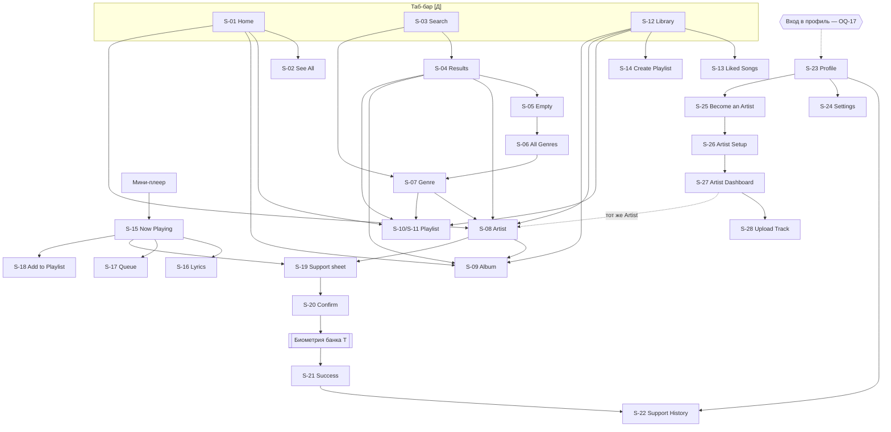

# Экраны, навигация и дизайн-структура — Mmusic

> Разделы 4 и 6 ТЗ. Источник: `stitch_mmusic_mobile_streaming_app/` (макеты PNG + HTML) и `nocturne_audio/DESIGN.md`.
> Метки: **[Д]** — в дизайне, **[П]** — предложение, **[Т]** — технически необходимо, нет в дизайне, **OQ-NN** — открытый вопрос.

## 0. Замечания по исходникам дизайна

| Наблюдение | Последствие |
|---|---|
| 5 файлов `screen.png` повреждены (вместо картинки текст «FIFE Image failed to fetch»): `empty_search_state`, `profile_hub_mmusic`, `settings_audio_account`, `support_history_mmusic`, `support_success_solaris_echo` | Анализ этих экранов сделан по `code.html` (отрендерен в браузере). Желательно перевыгрузить PNG из Stitch |
| `see_all_new_releases_trending_1` и `_2` — один и тот же экран (различаются только URL картинок) | Считаем одним экраном S-02 |
| Две разные страницы плейлиста (`playlist_detail`, `playlist_late_night_flow`) | OQ-18 |
| Три способа создать плейлист (полный экран, модалка в Library, пункт в Add to Playlist) | OQ-19 |
| Мини-плеер отличается набором кнопок на разных экранах | Нужен один канонический вариант (OQ-28) |
| Картинки в макетах — заглушки с внешних URL Google (`lh3.googleusercontent.com`) | В продукте не используются; обложки приходят из каталога |
| Все тексты в макетах на английском | Языки интерфейса — OQ-33 |
| **2026-10-06:** добавлен второй пакет экспорта Stitch (8 папок) — Artist Flow | 4 экрана (`become_an_artist_onboarding`, `artist_setup_profile_details`, `artist_dashboard_mmusic`, `upload_track_publishing_states`) каталогизированы как S-25…S-28 (раздел 2). `profile_hub_mmusic` переэкспортирован с новым пунктом «Become an Artist» — см. обновлённый S-23 |
| В этом же пакете — 3 экрана более широкой концепции «Mmusic Studio / Artist Studio» (`mmusic_studio`, `mmusic_boost`, `midnight_mirage`): тарифы, платное продвижение, аналитика трека, на русском языке, со своим таб-баром Overview / Analytics / Promotion / Studio Pro | **[П] Решение 2026-10-06:** вне скоупа текущей фазы, в каталог не включены, не проектируются и не реализуются. Конфликтуют по языку (OQ-33) и по навигации (таб-бар) с остальным приложением |

## 1. Карта навигации

**Правила навигации**
- [Д] Таб-бар (Home / Search / Library) и мини-плеер видны на корневых и вложенных экранах контента. На полноэкранном плеере, Lyrics, Queue и в шторках их нет.
- [Д] Вложенные экраны имеют кнопку «назад» в шапке.
- [П] Каждая вкладка хранит свой стек навигации. Повторный тап по активной вкладке возвращает к корню вкладки.
- [Д] Полноэкранный плеер открывается тапом по мини-плееру, закрывается стрелкой «вниз» [П: и свайпом вниз].
- [Т] Deep links: `mmusic://track/{id}`, `/album/{id}`, `/artist/{id}`, `/playlist/{id}` для кнопок Share.
- **[П] Решение 2026-10-06 (Artist Flow):** S-25…S-28 — обычные экраны в стеке профиля (как S-24 Settings), без собственного таб-бара. Исходник Stitch для S-27 Artist Dashboard содержит нижний таб-бар Overview / Analytics / Catalog / Payouts — он **не реализуется** в этой фазе (Analytics и Payouts вне скоупа, см. OQ-51); основной таб-бар (Home / Search / Library) не заменяется и не дублируется.

## 2. Каталог экранов

Обозначения состояний: **З** — загрузка, **П** — пусто, **О** — ошибка. Если состояние не задизайнено, оно помечено [Т] и строится на компонентах дизайн-системы.

### S-01 Home — `home_feed` [Д]
- **Назначение:** стартовый экран, персональная подборка и дискавери.
- **Элементы:** логотип Mmusic; «For you» (сетка 2×3 плиток: обложка + название); featured-баннер 16:9 («Late Night Flow», Play); «Trending Now» (карточки с ♥, «See All»); «New Releases» (карточки с типом релиза, «Explore»); «Jump Back In» (4 строки треков, «History»); «Mood & Vibe Mixes — Tuned to You» (4 карточки с иконкой и числом треков); мини-плеер; таб-бар.
- **Действия:** тап по плитке или карточке → сущность; Play на баннере → воспроизведение; ♥ → в избранное; «⋮» → меню трека; See All / Explore → S-02; History → OQ-39.
- **Состояния:** З — скелетоны секций [Т]; П — для нового пользователя нет «Jump Back In» и персональных блоков, показываем редакционный контент [П]; О — экран ошибки с повтором [Т].

### S-02 See All (New Releases / Trending) — `see_all_new_releases_trending_1` [Д]
- **Элементы:** «назад», заголовок «See All», кнопка фильтра/шаринга; чипы This Week / Top Charts / Albums / Singles; hero-релиз (название, артист, число треков, Listen Now, bookmark_add, «⋯»); «Fresh Finds» (горизонтальная лента, See all).
- **Действия:** переключение фильтра, воспроизведение, сохранение, открытие релиза.
- **Состояния:** З [Т], П — «Нет релизов за период» [Т], О [Т].

### S-03 Search — Explore — `search_explore` [Д]
- **Элементы:** логотип; кнопки Cast и Notifications (OQ-27, OQ-28); поле «What do you want to listen to?» с микрофоном (OQ-26); «Recent Searches» (чипы с ×, Clear all); «Trending Searches» (4 пункта с номерами); «Browse All»: баннер Kyrgyz Music и сетка 12 жанров.
- **Действия:** фокус на поле → ввод → S-04; тап по недавнему или трендовому → поиск; × и Clear all — удаление; тап по жанру → S-07 или S-06.
- **Состояния:** П — нет недавних поисков, блок скрыт [П]; З и О [Т].

### S-04 Search Results — `search_results` [Д]
- **Элементы:** поле с запросом и ×; чипы All / Songs / Artists / Albums / Playlists; Top Result (артист + Play); Songs (строки с ♥ и ⋮, See all); Artists (карточки); Albums & EPs; Featured Playlists.
- **Действия:** фильтрация, воспроизведение, переход к сущности, лайк, меню трека.
- **Состояния:** П → S-05 [Д]; З — скелетоны при наборе [Т]; О [Т].

### S-05 Empty Search — `empty_search_state` [Д]
- **Элементы:** поле с запросом; чипы фильтров; иллюстрация `search_off`; «No results for “…”»; подсказка проверить написание; кнопка «Explore All Genres»; «Trending right now» — 5 чипов.
- **Действия:** Explore All Genres → S-06; тап по чипу → новый поиск.

### S-06 All Genres & Moods — `all_genres_browse_hub` [Д]
- **Элементы:** заголовок и подзаголовок «Explore 24+ sonic realms»; кнопка фильтра (tune); чипы All / Genres / Moods & Activities / Regional & Heritage; hero «Kyrgyz Music & Central Asian Beats» (слушатели, Explore Culture, bookmark); «Curated Realms (12)» — плитки 2 колонки с номером, категорией и названием; карточка «Looking for personal mixes?» →; мини-плеер; таб-бар (активна Search).
- **Действия:** фильтр, переход в жанр, сохранение жанра, переход к персональным миксам (экран не задизайнен — OQ-42).
- **Состояния:** З и О [Т].

### S-07 Genre / Category — `genre_category_kyrgyz_music` [Д]
- **Элементы:** метка «Explore genre • Central Asia», Share, ♥; hero «Steppe Resonance» (слушатели, описание, Listen Now, Follow); «Essential Compilations» (карточки с числом треков и Play, See all); «Pioneering Artists» (круглые аватары с verified и числом фанатов, Explore); «Trending in Bishkek — Live Top 50» (строки, Play All); «New Releases» (All releases); плашка «Spatial Audio Enabled» с кнопкой Tune.
- **Действия:** воспроизведение, Follow жанра, переход к артисту, подборке или релизу; Tune → настройки аудио [П].
- **Состояния:** З, П, О [Т].

### S-08 Artist Profile — `artist_profile_mmusic_pure` [Д]
- **Элементы:** шапка (назад, Share, ⋮); hero-фото с именем, verified, слушателями; кнопки Following, Support, большой Play с бейджем Shuffle; «Popular — Top 5» (строки с plays и ⋯, активный трек с эквалайзером); «Releases (12)» с чипами All / Albums / Singles & EPs; «Fans Also Like»; «About» (локация, жанры, био, Read more); мини-плеер.
- **Скрытый оверлей в HTML:** панель «Support Solaris Echo — Direct studio patronage» с вариантами $3 Coffee / $10 Synth Cable / $25 Vinyl Press и кнопкой «Send $10 Patronage» → конфликт валют, **отвечено 2026-10-06: канонична валюта сом/KGS (S-19), вариант в `$` не используется** (OQ-08).
- **Действия:** Follow / Unfollow, Play / Shuffle, Support → S-19, переход к релизу или похожему артисту, Read more.
- **Состояния:** З и О [Т]; у артиста нет релизов → секция скрыта [П].

### S-09 Album — `album_horizon_deluxe` [Д]
- **Элементы:** шапка «Album» (назад, Share, ⋯); обложка со свечением; название; артист (аватар + ссылка); год • число треков, длительность; ♥ Save, Download, ⋯, Shuffle, Play; «Tracks» — пронумерованные строки (E, активный трек, ⋮); футер с датой релиза и ℗; мини-плеер.
- **Действия:** Play / Shuffle, сохранение, загрузка, меню трека, переход к артисту.
- **Состояния:** З и О [Т]; загрузка альбома — прогресс на кнопке [П].

### S-10 Playlist Detail, вариант A — `playlist_detail` [Д]
- **Элементы:** шапка приложения (логотип, ⋮, аватар профиля); назад, Share, ⋯; обложка; бейдж «Editorial Playlist»; название; «Curated by Mmusic • 28 tracks • 1 hr 45 min»; Play All, Shuffle, Download, Sort; таблица # / Title / ⏱ — строки с обложкой, ♥ и ⋮; мини-плеер (с Cast).
- **Действия:** воспроизведение, лайк, сортировка, загрузка, меню трека.

### S-11 Playlist Detail, вариант B — `playlist_late_night_flow` [Д]
- **Элементы:** «Playlist Details» (назад, Share, ⋯); большая обложка; «Editorial Playlist • Updated Daily»; название; описание; «Curated by Mmusic Editorial» (verified); лайки, длительность, число треков; ♥, Download, ⋯, Shuffle, PLAY; поле «Find in playlist»; чипы All / Downloaded / Ambient / Modular; строки с бейджем LOSSLESS; «About This Playlist»; мини-плеер; таб-бар.
- **Каноничность A или B — OQ-18.** [П] B — для редакционных плейлистов, A — для пользовательских.
- **Состояния (A и B):** П — «В плейлисте пока нет треков» + кнопка «Добавить» для своего плейлиста [Т]; З и О [Т].

### S-12 Your Library — `your_library` [Д]
- **Элементы:** заголовок; поиск; «+»; поле «Find in Playlists, Artists, Albums…»; чипы All / Playlists / Artists / Albums / Downloaded / Podcasts & Shows; сортировка «Recently Added ▾»; переключатель вида; карточка Liked Songs (число треков, Play); смешанный список (плейлист, артист с →, альбом с download_done, Editorial).
- **Скрытый оверлей в HTML:** модалка «New Playlist — Name your collection» (поле, Cancel / Create), см. OQ-19.
- **Действия:** фильтр, сортировка, поиск, переход к сущности, создание плейлиста, ⋮ (меню элемента).
- **Состояния:** П — новый пользователь: только Liked Songs (0) и призыв найти музыку [Т]; З и О [Т].

### S-13 Liked Songs — `liked_songs_mmusic` [Д]
- **Элементы:** обложка с сердцем; «Auto Playlist»; «Liked Songs»; «324 saved tracks • 18 hrs 42 mins»; Play All, Shuffle, Download offline, Sort; колонки Title / Duration; строки с ♥ (снять лайк) и ⋮; мини-плеер (Prev / Play / Next); таб-бар.
- **Скрытый оверлей в HTML:** **меню трека** (bottom sheet) — Add to playlist, View artist, Go to album, Share track, Cancel [Д].
- **Состояния:** П — «Лайкайте треки, и они появятся здесь» [Т]; З и О [Т].

### S-14 Create Playlist — `create_playlist` [Д]
- **Элементы:** шапка (Cancel / Create Playlist / Create); блок обложки «Add Cover — Custom art or photo» + кнопки «AI Generate» и «Color Wave»; поле Name (счётчик 0/50, кнопка очистки); Description (Optional); переключатели Public Playlist (вкл. по умолчанию [Д]) и Collaborative; главная кнопка «Create Playlist» (неактивна при пустом имени [Д]).
- **Действия:** выбор фото (камера или галерея, нужны разрешения [Т]), AI-обложка (OQ-24), ввод данных, создание.
- **Состояния:** О — ошибка сохранения [Т]; валидация имени [Т].

### S-15 Now Playing (полноэкранный плеер) — `now_playing_mmusic_pure` [Д]
- **Элементы:** свернуть (˅); «Playing from Album — Horizon»; ⋯; обложка со световым ореолом (цвет берётся из обложки); название; артист →; ♥; прогресс-бар со скраббером; 2:18 / −1:27; Shuffle, Prev, Play/Pause (64px), Next, Repeat; нижняя панель: Lyrics / Queue / Support / Audio.
- **Действия:** все контролы; Lyrics → S-16; Queue → S-17; Support → S-19; Audio → OQ-29; ⋯ → меню трека (Add to playlist → S-18); артист → S-08.
- **Состояния:** буферизация — индикатор на Play [Т]; ошибка воспроизведения — тост и пропуск трека [Т]; нет сети — офлайн-баннер [Т].

### S-16 Synchronized Lyrics — `synchronized_lyrics_midnight_mirage` [Д]
- **Элементы:** свернуть; название и артист; Share; строки текста (активная крупная белая с красным маркером, соседние приглушены или размыты); прогресс и время; Prev / Pause / Next; вкладки Lyrics / Audio / Queue.
- **Действия:** автопрокрутка; [П] тап по строке → перемотка к ней; Share строки.
- **Состояния:** П — «Текст недоступен» [Т]; несинхронизированный текст — статичный список [П].

### S-17 Playback Queue — `playback_queue_mmusic` [Д]
- **Элементы:** «Playback Queue» (назад, ⋯); Now Playing (карточка с ♥); «Playing Next» — строки с drag-handle; переключатель «Infinity Autoplay — Keep playing similar music»; мини-плеер.
- **Действия:** перестановка, [П] свайп для удаления из очереди, тап → воспроизвести с этого трека, Autoplay вкл./выкл.
- **Состояния:** П — «Очередь пуста» [Т].

### S-18 Add to Playlist (bottom sheet) — `add_to_playlist_drawer` [Д]
- **Элементы:** тост «✓ Added to Late Night Flow»; заголовок «Add to Playlist — Choose one or more destinations»; ×; карточка текущего трека с длительностью; поиск «Find a playlist…»; «New Playlist — Create and auto-insert current track» →; список плейлистов (число треков, «Updated 2h ago», кнопки + / ✓); Done.
- **Действия:** мультивыбор, поиск, создание нового, закрытие.
- **Состояния:** П — нет своих плейлистов, видна только «New Playlist» [Т].

### S-19 Support Artist — быстрый донат (bottom sheet) — `artist_support_quick_donation_sheet` [Д]
- **Элементы:** фон — размытая страница артиста; ручка шторки; «Support Artist — Direct artist patronage for {артист}»; ×; круглые кнопки сумм 10 / 50 / 100 / 500 сом + «More» (♥); выбранная сумма подсвечена; CTA «⚡ Support with 100 сом»; «🔒 Direct payout to artist • Instant settlement via MBANK».
- **Действия:** выбор суммы, More → ввод своей суммы ([Т], экран не задизайнен, OQ-09), CTA → S-20.

### S-20 Donation Confirmation (bottom sheet) — `donation_confirmation_sheet` [Д]
- **Элементы:** аватар артиста с verified; «Support {артист}»; описание артиста; «Contribution Amount 50 сом»; счёт «MBANK account •••• 4892 • Direct • Available: 14,250 сом»; гарантия «100% … No gateway deduction»; «Confirm & Send 50 сом ⚡»; Cancel.
- **Действия:** подтверждение → биометрия [Т] → S-21; отмена.
- **Состояния [Т, OQ-14]:** недостаточно средств (CTA неактивна, сообщение); обработка (спиннер на CTA, блокировка повторного нажатия); ошибка банка; таймаут; выбор другого счёта (OQ-14).

### S-21 Support Success — `support_success_solaris_echo` [Д]
- **Элементы:** иконка ♥ с ореолом; «Direct Patronage Complete»; «Supported 50 сом»; чип артиста; «Authorized via MBANK Biometric • 0 Fee»; цитата-заметка «Attached Note • Publicly Pinned» (OQ-11); «Top 1% Patron — Unlocked — Exclusive Acoustic Badge & Stems Access» (OQ-12); Done ✓; «View Support Receipt in History»; «Resuming audio playback upon exit».
- **Действия:** Done → возврат на исходный экран и возобновление аудио; ссылка → S-22.

### S-22 Support History — `support_history_mmusic` [Д]
- **Элементы:** назад; «Support History»; иконка квитанций; баннер «Zero Platform Fees • 100% to Artists», «Total Supported 650 сом», «Direct patronage to 5 independent creators», «MBANK Instant Settlement Secured»; чипы All / This Month / Top Supported / Receipts; группы Today / Last Week / September; карточки (артист-ссылка, назначение, сумма, статус Completed, дата и время, способ); футер «MBANK Direct Creator Network».
- **Расхождение:** профиль показывает «8 artists», история — «5 independent creators» (мок-данные; значения считаются из данных).
- **Состояния:** П — «Вы ещё не поддерживали артистов» + CTA к дискавери [Т]; статусы Pending / Failed / Refunded [Т, OQ-16]; З и О [Т].

### S-23 Profile Hub — `profile_hub_mmusic` [Д]
- **Элементы:** назад; «Profile»; ⋮; аватар с кнопкой редактирования; имя, verified, @username, «Member since 2023»; бейдж «MBANK VIP SOUND»; счётчики 482 Saved / 38 Playlists / 650 сом Supported; «Listening Pulse — This Month» (Top Artist, 42 hrs listened, Top Genre); «Studio Sanctuary»: Support History, Audio Quality & Playback, Downloads & Offline (14.2 GB • 348 songs), Account & Security (MBANK Connected ID), **Become an Artist** (иконка mic, подпись «Publish and monetize your tracks on Mmusic») [Д, добавлено в экспорте 2026-10-06]; Log Out; мини-плеер.
- **Действия:** редактирование аватара, переход в разделы, выход [П: с подтверждением]; **Become an Artist → S-25** (для пользователей без артист-профиля).
- **Точка входа — OQ-17.** [П] Аватар в шапке Home / Library (как на S-10 и S-14).
- **[Доп]** Для пользователя, уже являющегося артистом, пункт «Become an Artist» логично заменить на «Artist Dashboard» (прямая ссылка на S-27) — в дизайне не отражено, условный рендеринг нужно подтвердить.

### Artist Flow — S-25…S-28 (экспорт Stitch от 2026-10-06)
Путь: **Profile Hub (S-23) → Become an Artist (S-25) → Artist Setup (S-26) → Artist Dashboard (S-27) → Upload Track (S-28)**. Токены цвета/типографики/радиусов идентичны остальному приложению (раздел 3) — новых значений не introduced. Все 4 экрана — стек-экраны (шапка с «назад»), без отдельного таб-бара (см. решение в разделе 1).

### S-25 Become an Artist — `become_an_artist_onboarding` [Д]
- **Элементы:** шапка «Become An Artist» (назад, аватар профиля); иконка-эквалайзер в круге со свечением; заголовок «Share Your Sound with the World»; подзаголовок; 3 строки-преимущества (Share Your Music / Fan Support / Artist Insights) — переиспользуют компонент **Menu row / Settings group card** (раздел 3.5); основная кнопка-пилюля «Become an Artist →».
- **Действия:** Become an Artist → S-26.
- **Переиспользование:** кнопка-пилюля и Menu row — существующие компоненты дизайн-системы, новых не создаётся.
- **Состояния:** нет отдельных; тост «Initializing Artist Studio setup…» в исходном HTML — декоративный, без реального запроса [Т, уточнить при реализации].

### S-26 Artist Setup — `artist_setup_profile_details` [Д]
- **Элементы:** шапка «Artist Setup»; загрузка фото артиста (круглый аватар + кнопка камеры) — переиспользует паттерн аватара из S-23; поле «Artist / Stage Name»; чипы выбора основного жанра (переиспользуют **Chip / filter pill**, раздел 3.3); поле «Short Bio» (textarea, лимит 300 симв.); поле «Location / Base City»; кнопка «Create Artist Profile →»; дисклеймер об Artist Terms.
- **Действия:** Create Artist Profile → создаёт Artist-профиль, привязанный к текущему User (решение пользователя №1, см. architecture.md §6) → S-27.
- **Пробел:** нет шага привязки счёта для выплат (MBANK payout account), хотя модель Artist в architecture.md уже содержит `payoutAccountRef` — см. **OQ-48**. Нет явного шага подтверждения/модерации — см. **OQ-49**.
- **Состояния:** валидация пустого имени, ошибка сохранения — не задизайнены [Т].

### S-27 Artist Dashboard — `artist_dashboard_mmusic` [Д]
- **Элементы:** шапка «Artist Dashboard» (назад, профиль); кнопка «Upload Track» (переиспользует **Primary pill**, раздел 3.3); 3 статистические плитки Listeners / Streams / Support — переиспользуют **Stat card** (раздел 3.4, как на S-23 Listening Pulse); «Your Releases» с фильтр-чипами All / Published / In Review; список треков — переиспользует **Track row** (раздел 3.5), с добавлением статуса (Published / Transcoding) и, для обрабатываемого трека, прогресс-бара.
- **Действия:** Upload Track → S-28; тап по треку → существующий трек/альбом (тот же каталог, раздел «Переиспользование данных» ниже); фильтрация по статусу.
- **Из исходника, но не реализуется в этой фазе:** нижний таб-бар Overview / Analytics / Catalog / Payouts — Analytics и Payouts вне скоупа (см. §0, OQ-51); в этой фазе экран показывает только содержимое «Overview» без таб-бара.
- **Переиспользование данных:** артист на S-27 — та же сущность Artist, что отображается публично на **S-08 Artist Profile**; опубликованные треки — та же сущность Track/Album, что и в остальном каталоге (Album, Now Playing, Search и т.д.), без дублирования моделей (решения пользователя №1–2).
- **Состояния:** пусто — у нового артиста нет треков → CTA «Upload your first track» [Т, не задизайнено]; З и О [Т].

### S-28 Upload Track — `upload_track_publishing_states` [Д, неполный]
- **Элементы:** шапка «Upload Track»; секция «Upload Audio» (имя файла, длительность, статичная waveform-иллюстрация, Browse File); секция «Track Details» (Title, Artist/Featured Collaborators, Genre — переиспользуют поля ввода из S-14/S-26); секция «Cover Artwork» (превью + Change Cover, переиспользует паттерн из S-14); секция «Release Settings» (переключатель Release Now / Schedule, Date/Time при Schedule, переключатель Explicit Content Yes/No); кнопка «Publish Track →»; ссылка «Save as Draft».
- **Пробел — [Т, см. OQ-50]:** в исходном HTML есть JS-функция `switchState()`, переключающая блоки `#state-uploading / #state-processing / #state-success / #state-error`, но сами эти блоки **не экспортированы** — в дизайне есть только состояние формы ввода. Загрузка файла, прогресс транскодирования, экран успеха и экран ошибки публикации не задизайнены.
- **Действия:** Browse File — выбор аудиофайла [Т, системный пикер]; Publish Track → создание Track в существующем каталоге (TrackArtist на текущего Artist, см. architecture.md §6) → ожидаемое состояние processing → published [Т, детали в OQ-50]; Save as Draft → сохранение без публикации [Т, поведение не определено дизайном].

### S-24 Settings (Audio & Account) — `settings_audio_account` [Д]
- **Элементы:** «Profile Settings»; поиск по настройкам; секции: Audio Streaming & Lossless (Lossless, Wi-Fi Quality, Cellular Quality, Dolby Atmos, Volume Normalization); Downloads & Storage (Download Quality, Download over Cellular, Storage Used с разбивкой Music / Cache, Clear Cache); Playback & Sound Engine (Crossfade 0–12 с, Gapless, Equalizer → экран EQ не задизайнен); Account & Payments (MBANK Fast-Pay Authorization — Biometric Active, Artist Support Receipts — monthly email); футер: версия, «Powered by MBANK Core Architecture», Terms / Privacy / Audio Licenses.
- **Не задизайнены [Т]:** экраны выбора качества, эквалайзер, Account & Security, Downloads & Offline (OQ-42).

### Технически необходимые экраны и состояния вне дизайна [Т]
| ID | Экран / состояние | Почему нужен |
|---|---|---|
| T-01 | Splash / запуск | Инициализация сессии и плеера |
| T-02 | Вход / передача сессии из MBANK, «сессия истекла» | Без авторизации нет персональных данных (OQ-07) |
| T-03 | Ввод своей суммы доната («More») | Кнопка есть в S-19 |
| T-04 | Системный диалог биометрии / PIN банка | Указан на S-21 |
| T-05 | Ошибки платежа | Деньги — обязательная обработка отказов |
| T-06 | Глобальные ошибки: нет сети, сервер недоступен, трек недоступен в регионе | Устойчивость |
| T-07 | Разрешения ОС (уведомления, фото для обложки) | Требование iOS / Android |
| T-08 | Состояния публикации трека: загрузка файла (прогресс), транскодирование, успех, ошибка | Кнопка есть на S-28, экраны/состояния не задизайнены (OQ-50) |

## 3. Дизайн-система и компоненты (раздел 6 ТЗ)

### 3.1 Токены [Д, DESIGN.md]
- **Цвета:** canvas `#0A0A0C`; поверхности L1 `#141418`, L2 `#1C1C24`, L3 `#282834`; primary `#FF4B4B`; secondary (золото, Hi-Res/VIP) `#F5A623`; tertiary `#FF7A59`; текст `#FFFFFF` / `#9E9EA8` / `#5A5A66`; граница `rgba(255,255,255,0.08)`. В HTML макетов используется Material-палитра (surface `#131315`, primary `#ffb3ae`, primary-container `#ff5351`). [П] Источником правды считаем раздел «Colors» в DESIGN.md, Material-токены сводим к нему.
- **Скругления:** sm 4 / default 8 / md 12 / lg 16 / xl 24 / full; обложки 20–24px; карточки и шторки 16px; инпуты 12px; пилюли — full.
- **Отступы:** поля 20px, gutter 16px, шкала 4 / 8 / 12 / 20 / 32; нижний отступ 96px под мини-плеер и таб-бар.
- **Эффекты:** blur 24px (карточки), 40px (оверлеи); свечение обложки — blur 64px, 30%; тень primary-кнопки `0 4px 20px rgba(255,75,75,.35)`; нажатие — scale 0.96, 150 мс.

### 3.2 Типографика [Д]
| Токен | Шрифт | Размер / вес | Где |
|---|---|---|---|
| display-lg / -mobile | Plus Jakarta Sans | 36 / 28, 800 | Название в hero, «Liked Songs», «Your Library» |
| headline-lg | Plus Jakarta Sans | 24, 700 | Заголовки секций, название трека в плеере |
| headline-md / sm | Plus Jakarta Sans | 20 / 18, 600 | Подзаголовки, заголовки шторок |
| body-lg / md / sm | Inter | 16 / 14 / 12, 400 | Текст, артисты, мета |
| label-lg / md / sm | Inter | 14 / 12 / 10, 600–700 | Кнопки, чипы, UPPERCASE-метки (+0.06em) |
| mono-num | Inter, tabular-nums | 11, 500 | Таймкоды, длительности, битрейт |

### 3.3 Кнопки [Д]
| Тип | Вид | Примеры |
|---|---|---|
| Primary pill | `#FF4B4B`, белый текст, свечение | Play All, Listen Now, Support with…, Confirm & Send, Create Playlist |
| Primary circle | 48–64px, коралловый | Play в плеере, на баннере, у артиста |
| Secondary glass | `rgba(255,255,255,.08)` + граница | Following, Follow, Shuffle, Cancel, Done |
| Icon button (круг) | L2-поверхность, 40–48px | ♥, Download, ⋯, Share, Sort, × |
| Text link | Коралловый UPPERCASE / label | See All, Explore, History, Clear all |
| Chip / filter pill | 32px; выбранный — коралловый градиент или белый | Фильтры поиска, библиотеки, жанров, истории |
| Amount chip | Круг 64px с суммой и подписью | 10 / 50 / 100 / 500 / More |
| Toggle switch | Коралловый во вкл. состоянии | Public, Collaborative, Autoplay, настройки |
| Bottom-tab | Иконка + подпись, активная коралловая | Home / Search / Library |

### 3.4 Карточки [Д]
Quick tile (For you, 2×3) · Featured banner 16:9 · Release card 1:1 (название, артист, тип) · Trending card с ♥ · Mood card (иконка, число треков, подпись) · Genre tile (фото + заголовок) · Realm tile (номер, категория) · Compilation card (число треков, Play) · Artist avatar (круг, verified, фанаты) · Top-result card · Liked Songs card (градиент) · Stat card (Saved / Playlists / Supported) · Insight card (Listening Pulse) · Donation history card · Settings group card.

### 3.5 Списки [Д]
- **Track row** 56px: номер / обложка 40px / эквалайзер → название + артист (+ E / LOSSLESS) → ♥ → длительность → ⋮.
- **Queue row:** обложка → название / артист → длительность → drag-handle.
- **Library row:** обложка (квадрат) или аватар (круг) → название → тип • мета → ⋮ / → / download_done.
- **Playlist picker row:** обложка → название / число треков → кнопка + / ✓.
- **Menu row:** иконка в круге → заголовок / подзаголовок → chevron.
- **Lyrics line:** активная / соседняя / дальняя (3 уровня прозрачности и размытия).

### 3.6 Компоненты плеера [Д]
Mini-player (blur, прогресс 2px сверху, обложка, текст, 1–3 контрола) · Full-player header («Playing from…») · Artwork с цветным ореолом · Scrubber (трек, заполнение, круглый thumb) + таймкоды · Transport controls (Shuffle, Prev, Play 64px, Next, Repeat) · Player tab bar (Lyrics / Queue / Support / Audio) · Equalizer-индикатор (3 полосы, анимация) · Autoplay toggle.

### 3.7 Шторки и модалки [Д]
Track options sheet · Add to Playlist sheet (+ тост) · Support amount sheet · Donation confirmation sheet · New Playlist modal (Library) · Success overlay (S-21). Все шторки: ручка сверху, × или Cancel, фон с blur 40px [Д]; [П] закрытие свайпом вниз и тапом по фону (кроме подтверждения платежа во время обработки).

### 3.8 Пустые состояния [Д / Т]
Задизайнено только **пустое состояние поиска** (S-05: иконка, заголовок, подсказка, CTA, альтернативы). [П] Остальные пустые состояния строим по тому же шаблону: иконка в круге → заголовок → подсказка → CTA.

### 3.9 Повторяющиеся паттерны
Секция с заголовком + ссылка «See All» справа · горизонтальные ленты со snap · hero с градиентом снизу (0 → 80% чёрного по нижним 40%) · чипы-фильтры под заголовком · закреплённый мини-плеер + таб-бар · verified-галочка у артистов и кураторов · бейджи «E», «LOSSLESS», «Editorial».
