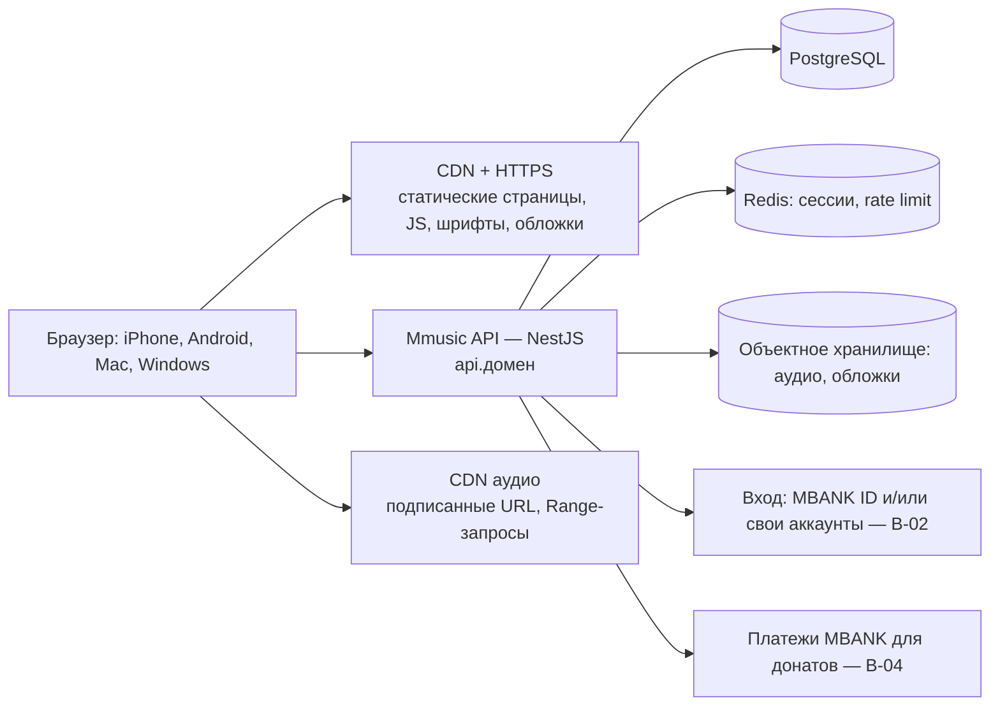

# Mmusic как самостоятельный веб-сайт: аудит и план

> Дата: 2026-10-08. Статус: **на утверждение**. Код приложения не менялся, зависимости не устанавливались.
> Основание: решение руководства. Mmusic — **самостоятельный сайт** с собственным доменом и публичным URL, а не нативное приложение. Доступ из Safari, Chrome и других современных браузеров на iPhone, Android, Mac и Windows.
> Метки: [Ф] факт, проверенный в проекте; [П] предложение; [Р] риск; **В-NN** — вопрос на ваше решение (§8).

**Что меняется относительно прежних решений.**
- Раньше (OQ-02, 2026-10-06) платформой были мобильное приложение и WebView внутри MBANK. Новое решение делает основной поверхностью **публичный сайт**.
- Сохраняется ли WebView в MBANK и нативная сборка — вопрос **В-01**.
- Архитектура бэкенда из `docs/architecture.md` остаётся целевой. Меняются клиентская платформа, способ входа и хостинг.

---

## 1. Аудит текущей архитектуры

### 1.1. Что есть сейчас [Ф]

| Область | Состояние |
|---|---|
| Монорепозиторий | pnpm + turbo: `apps/mobile` (Expo SDK 57, Expo Router), `apps/api` (NestJS, только `GET /health`), `packages/design-tokens` |
| Веб-сборка | `expo export --platform web`, `web.output: "static"`. Получается **48 предрендеренных HTML-страниц** и один JS-бандл |
| Размер сборки | JS 3,2 МБ (**≈ 764 КБ gzip**, один файл на весь сайт); шрифты TTF в сборке 9,2 МБ (загружаются 7 начертаний + 2 иконочных шрифта); обложки JPG/PNG ≈ 3 МБ; демо-аудио MP3 7,3 + 5,6 МБ |
| Маршруты | 40+ экранов: вкладки Home / Search / Library, Artist, Album, Playlist, Player (Now Playing, Lyrics, Queue), Profile (Settings, Account, Audio, Downloads, Support History, Artist Flow), листы (Options, Support, Add to Playlist, Demo audio, Notifications) — **всё по URL** |
| Динамические страницы | `artist/[id]`, `album/[id]`, `playlist/[id]` предрендерены только для одного `id` каждая (`generateStaticParams`); остальные `id` обслуживает шаблон `[id].html` |
| Данные | Моки в `src/mocks`, состояние в Zustand-сторах. **Ничего не сохраняется**: перезагрузка страницы сбрасывает лайки, плейлисты, очередь и настройки (Фаза 3 «Persistence» приостановлена) |
| Аудио | `expo-audio` за интерфейсом `AudioEngine`. На вебе это `HTMLAudioElement`; при каждой смене трека создаётся **новый** `<audio>` (`AudioPlayer.web.js`, `replace()`) |
| Плеер | Dynamic Premium: жесты, адаптивный фон, карусель, раскрытие и сворачивание — **уже работают в браузере** (проверено в Expo Web: мышь, Playwright, Back/Forward, Escape) |
| Раскладка на десктопе | Весь сайт — колонка шириной до 480 px по центру экрана (`MAX_CONTENT_WIDTH`) |
| Аккаунты | Нет. Профиль «MBANK Connected ID» — мок |

### 1.2. Маршрутизация, обновление страницы, deep links, Back/Forward

| Проверка | Результат |
|---|---|
| Back/Forward браузера | Работают. Закрытие плеера кнопкой «назад» анимируется (`beforeRemove`) [Ф] |
| Обновление страницы на `/player/now-playing` | Открывается плеер; «свернуть» ведёт на `/home` [Ф] |
| Обновление на любой странице | **Теряется состояние** (очередь, лайки, плейлисты, текущий трек) [Ф] |
| Чистые URL (`/artist/solaris-echo`) на простом статическом сервере | **404**: нужны правила переписывания на хостинге (`/artist/*` → `artist/[id].html`, `/player/now-playing` → `player/now-playing.html`) [Ф, проверено] |
| Новые `id` артистов, альбомов, плейлистов | Без правил переписывания — 404. С ними — шаблон страницы с данными, загружаемыми на клиенте |
| Листы (`/sheets/support` и др.) | Работают как маршруты. При прямом заходе под листом нет экрана [Р: проверить и решить, нужны ли листам собственные URL] |
| Служебные страницы | `dev-ui-kit` и `_sitemap` попадают в продакшен-сборку [Р] |

### 1.3. Подходит ли Expo Web для продакшен-сайта

**Вывод: да, с доработками, перечисленными в §2 и §5.**

Сильные стороны:
- один код с уже готовыми экранами;
- жесты плеера (Reanimated + Gesture Handler) работают в браузере;
- маршруты — это реальные URL;
- статическая выдача хорошо ложится на CDN.

Слабые стороны и что с ними делать:

| Слабость | Влияние | Что делать |
|---|---|---|
| Один бандл ≈ 764 КБ gzip | Медленный первый вход на мобильном 3G/4G | Ленивая загрузка маршрутов (`asyncRoutes` в Expo Router), вынос редких экранов (Artist Flow, Settings), бюджет размера в CI |
| SEO и превью ссылок ограничены | Страницы артистов и треков при шаринге без заголовков и картинок | Минимум: `<title>`, мета-теги, Open Graph на основных шаблонах. Для полноценного SEO каталога — серверный рендер (`web.output: "server"`, §2.2, вариант Б) |
| Пустой `<title>`, `lang="en"`, нет `viewport-fit=cover`, нет манифеста | Плохой вид во вкладках и при шаринге; на iPhone с вырезом неверные safe-area | Свой `+html.tsx`, мета-теги, Web App Manifest |
| `body { overflow: hidden }` (сброс Expo) | Вся прокрутка — во вложенных контейнерах | Сохраняем: это нужно для жестов плеера. Проверяем прокрутку колесом и клавиатурой на десктопе |
| Шрифты в TTF | Лишний вес | WOFF2 и только используемые начертания |

---

## 2. Рекомендуемая веб-архитектура

### 2.1. Варианты

| Вариант | Суть | Плюсы | Минусы | Оценка |
|---|---|---|---|---|
| **А. Оставить Expo Router Web, статическая выдача + CDN** [рекомендация] | Текущий код; сборка в статические файлы; хостинг с правилами переписывания; API отдельно (NestJS) | Без переписывания; жесты и плеер сохраняются; дешёвый и быстрый хостинг; нативная сборка остаётся возможной | SEO только на клиенте; нужна дисциплина по размеру бандла | **Для запуска** |
| Б. Expo Router с серверным выводом (`web.output: "server"`) | Тот же код, плюс серверный рендер страниц и API-маршруты | SEO и превью ссылок для каталога; тот же стек | Нужен Node-хостинг (не просто CDN); сложнее эксплуатация | **Следующий шаг**, если нужны индексируемые страницы артистов и треков (В-08) |
| В. Миграция на Next.js (+ react-native-web) | Переписать оболочку и маршрутизацию | Зрелый SSR, большая экосистема | Переписывание 40+ экранов и жестов; риск регрессий; месяцы работы. **Противоречит требованию «не перестраивать с нуля»** | Не рекомендуется |

**Рекомендация: вариант А сейчас, переход к Б только при подтверждённой потребности в SEO.** Код при этом не выбрасывается: А и Б — один и тот же Expo Router.

### 2.2. Целевая схема



Принципы:
1. **Фронтенд — статический** (вариант А). Данные — только через API. Секретов во фронтенде нет.
2. **Сессия — в httpOnly-cookie** (`Secure`, `SameSite=Lax`), а не в `localStorage`. API на поддомене того же сайта (`api.mmusic.<домен>`) или под путём `/api`. Так проще с CORS и cookies в Safari (ITP).
3. **Аудио** — короткоживущие подписанные URL с CDN. Хостинг обязан поддерживать HTTP Range (206): без этого Safari не перематывает и не играет длинные треки [Ф: простой сервер Range не поддерживает].
4. **Формат аудио на старте** — AAC/MP3 прогрессивно, без новых зависимостей. HLS в Safari работает нативно, в Chrome и Firefox нужен `hls.js` (новая зависимость, только с разрешения). Решается вместе с DRM (OQ-21).
5. **Интерфейс `AudioEngine` сохраняется.** Для Safari добавляется своя веб-реализация с **одним** переиспользуемым `<audio>` (§4.1, риск 1) и Media Session (экран блокировки, гарнитура).

### 2.3. Что остаётся без изменений

Экраны, бренд, Dynamic Premium Player (адаптивный фон, карусель, раскрытие и сворачивание), Lyrics, Queue, Library, Playlists, Artist, Search, Donations, Settings, сторы и их тесты. Добавления — это слои вокруг: оболочка для десктопа, сохранение данных, API-клиент, веб-аудио, хостинг.

---

## 3. Стратегия дизайна: мобильный, планшет, десктоп

Идентичность прежняя: ночная тёмная палитра, коралловый акцент только на главных действиях, Plus Jakarta Sans и Inter, адаптивный цвет плеера по обложке. Новых визуальных приёмов не добавляем: без стекла, свечения и декоративной анимации.

### 3.1. Точки перелома [П]

| Ширина | Раскладка | Навигация | Плеер |
|---|---|---|---|
| < 640 px (телефон) | Как сейчас, одна колонка | Нижние вкладки | Мини-плеер над вкладками; полный плеер со всеми жестами — **без изменений** |
| 640–1023 px (планшет) | Шире сетки (3–4 карточки в ряд), поля 32 px | Вертикальная панель-иконки слева (rail) | Мини-плеер внизу во всю ширину; полный плеер — двухколоночный (обложка слева, управление справа), жесты сохраняются |
| ≥ 1024 px (десктоп) | Боковая панель 240 px + контент (до ~1200 px) + опциональная правая панель | Боковая панель: Home, Search, Library, плейлисты пользователя, профиль | Постоянная **панель плеера внизу** (80 px); Now Playing открывается правой панелью или полноэкранным режимом; Lyrics и Queue — правая панель |

### 3.2. Каркас десктопа

```
┌──────────────┬───────────────────────────────────────┬──────────────┐
│ Mmusic       │  ← →   [ Поиск…                    ]  │  Queue /     │
│              │                                       │  Lyrics      │
│ ⌂ Home       │  For you                              │  (правая     │
│ ⌕ Search     │  ▢ ▢ ▢ ▢ ▢ ▢                          │  панель,     │
│ ♫ Library    │                                       │  по кнопке)  │
│              │  Trending in Bishkek                  │              │
│ Плейлисты    │  ▢ ▢ ▢ ▢ ▢ ▢                          │              │
│  • Late Night│                                       │              │
│  • Liked     │                                       │              │
├──────────────┴───────────────────────────────────────┴──────────────┤
│ ▣ Midnight Mirage · Solaris Echo  ♡   ⇄ ⏮ (▶) ⏭ ↻   0:41 ━━━○── 4:00  ≡ ☰ 🔊━━ │
└────────────────────────────────────────────────────────────────────┘
```

- **Панель плеера** — то же состояние и те же сторы, что у мини-плеера. Тон панели — та же палитра обложки (сдержанно, как у мини-плеера).
- **Полный Now Playing на десктопе** — адаптивный фон, крупная обложка, карусель. Мышью листается перетаскиванием и стрелками; колесо мыши не перехватываем.
- Ширина колонки 480 px остаётся только для телефонной раскладки.

### 3.3. Мышь и клавиатура (десктоп) [П]

| Клавиша | Действие |
|---|---|
| Пробел | Play / Pause (кроме полей ввода) |
| ← / → | Перемотка −5 / +5 с |
| Shift + ← / → | Предыдущий / следующий трек |
| ↑ / ↓ | Громкость (на панели плеера) |
| M | Выключить звук |
| / или Ctrl/⌘ + K | Фокус на поиск |
| L / Q | Lyrics / Queue |
| Esc | Закрыть лист, панель или полный плеер |

Также:
- **ховер-состояния** — кнопка Play на карточке при наведении, подсветка строк треков;
- **видимый фокус** для клавиатуры;
- **контекстное меню** по правому клику на треке — те же действия, что у листа Options;
- Media Session на всех платформах: клавиши медиа, экран блокировки, гарнитура.

### 3.4. Мобильный браузер [П]

- Жесты плеера сохраняются полностью.
- Учитываем жесты Safari:
  - свайп от левого края — «назад» браузера: карусель не начинается у самого края, Back уже корректно сворачивает плеер;
  - pull-to-refresh: `overflow: hidden` на `body` его отключает, проверяем на устройстве.
- `viewport-fit=cover` и `env(safe-area-inset-*)` для iPhone с вырезом.
- `100dvh` для полной высоты с учётом адресной строки.
- Возможность «Добавить на экран „Домой“» (Web App Manifest, иконки). Полноценный офлайн/PWA — отдельное решение (В-09).

### 3.5. Дизайн-материалы

Макеты Stitch описывают только мобильную ширину. Для планшета и десктопа нужно одно из двух:
- макеты от дизайнера;
- согласование по каркасам из §3.2 с последующей сборкой из существующей дизайн-системы.

Это вопрос **В-07**.

---

## 4. Риски совместимости браузеров

### 4.1. Аудио (главная зона риска)

| # | Риск | Где | Вероятность | Что делать |
|---|---|---|---|---|
| 1 | **Блокировка автозапуска.** `expo-audio` создаёт новый `<audio>` при каждой смене трека, а старт после свайпа отложен на 180 мс (вне жеста пользователя). Автопереход к следующему треку тоже идёт без жеста | iOS Safari, частично Chrome | Высокая | Веб-реализация `AudioEngine` с **одним** `<audio>`, разблокированным первым нажатием; смена `src` на нём. Проверка на iPhone — первым делом |
| 2 | Нет управления с экрана блокировки и гарнитуры | iOS / Android | Средняя | Media Session API (в `expo-audio` есть `setActiveForLockScreen`, или напрямую `navigator.mediaSession`) |
| 3 | Фоновое воспроизведение при заблокированном экране | iOS Safari | Средняя | Обычно работает для `<audio>`; проверить. Видео и Web Audio не использовать |
| 4 | Перемотка и длинные треки без HTTP Range | Safari | Высокая при неправильном хостинге | Хостинг и CDN с поддержкой 206 Partial Content |
| 5 | Lossless: FLAC не везде, HLS не нативен в Chrome и Firefox | Safari / Chrome / Firefox | Средняя | На старте AAC/MP3; lossless и HLS — после решения по OQ-22 и OQ-21 |
| 6 | Громкость из кода не меняется | iOS Safari | Факт платформы | На iPhone прячем слайдер громкости (системная громкость) |

### 4.2. Интерфейс и платформа

| Риск | Что делать |
|---|---|
| Safe-area на iPhone (нет `viewport-fit=cover`) | `+html.tsx` с правильным viewport |
| Высота экрана и адресная строка (`100vh`) | `dvh`, проверка раскрытия плеера |
| Конфликты жестов с системными жестами Safari (край экрана, pull-to-refresh) | Проверка на устройствах; карусель не у самого края |
| Firefox и Edge ещё не проверялись | Включить в матрицу тестов (§6) |
| Cookies и ITP Safari при API на другом домене | API на поддомене того же сайта, cookies с правильными атрибутами |
| Нет фокус-стилей и клавиатуры | §3.3 |

### 4.3. Производительность

| Риск | Цель (бюджет) [П] |
|---|---|
| JS 764 КБ gzip в одном файле | ≤ 300 КБ gzip на первый экран: ленивые маршруты, вынос Artist Flow и dev-экранов |
| Шрифты TTF | WOFF2, только 7 используемых начертаний, `font-display: swap`, предзагрузка двух основных |
| Обложки JPG без адаптивных размеров | Размеры 1×/2×, WebP/AVIF, ленивая загрузка вне экрана (`expo-image` поддерживает) |
| Аудио целиком (13 МБ демо) | Потоковая загрузка с Range, предзагрузка только следующего трека |
| Core Web Vitals | LCP < 2,5 с на 4G, INP < 200 мс, CLS < 0,1; анимации плеера — 60 к/с на среднем Android |

### 4.4. Безопасность

| Риск | Что делать |
|---|---|
| В продакшен попадают `dev-ui-kit`, `_sitemap`, мок-данные профиля | Исключить из продакшен-сборки |
| Нет заголовков безопасности | HTTPS + HSTS, CSP (скрипты только своего домена), `X-Content-Type-Options`, `Referrer-Policy`, `Permissions-Policy`, `frame-ancestors` (с учётом В-01: если сайт встраивается в MBANK, нужен его origin) |
| Токены в `localStorage` (XSS) | Только httpOnly-cookie (§2.2) |
| Донаты: подделка суммы, повторы | Серверная проверка, Idempotency-Key, аудит-лог (уже в архитектуре) |
| Бренд MBANK на публичном сайте | Юридическое согласование (OQ-01, В-05) |
| Права на контент и тексты песен в открытом интернете | OQ-04, OQ-23: публичный сайт — это публичное распространение |
| Злоупотребления API | Rate limiting, WAF, защита форм входа |
| Персональные данные и хранение в КР | OQ-36, В-06 |

---

## 5. Пошаговая дорожная карта

Каждый шаг — отдельное утверждение, тесты и локальные коммиты, как в предыдущих фазах. Шаги W1–W3 не требуют бэкенда и новых зависимостей (кроме отмеченных).

| Шаг | Содержание | Зависит от |
|---|---|---|
| **W0. Решения** | Ответы на §8; при необходимости макеты десктопа | — |
| **W1. Веб-фундамент** | `+html.tsx` (title, мета, Open Graph, `lang`, `viewport-fit`), Web App Manifest и иконки; исключить dev-экраны из продакшена; страница 404; конфигурация переписывания URL и кеширования для выбранного хостинга; WOFF2-шрифты; ленивые маршруты и бюджет размера | В-06 (хостинг) |
| **W2. Веб-аудио** | Веб-реализация `AudioEngine` с одним `<audio>` (решение автозапуска в Safari), Media Session, обработка ошибок воспроизведения; **ранняя проверка на iPhone** | — |
| **W3. Адаптивная раскладка** | Точки перелома; оболочка планшета (rail) и десктопа (боковая панель, панель плеера, правая панель Queue/Lyrics); ховер, фокус, горячие клавиши; полный плеер на десктопе. Телефонная раскладка не меняется | В-07 |
| **W4. Сохранение у гостя** | Возобновление Фазы 3 для веба: лайки, плейлисты, настройки, последняя очередь в `localStorage` через встроенный `persist` Zustand — **без** AsyncStorage | Возобновление Фазы 3 |
| **W5. Бэкенд MVP** | `apps/api`: пользователи, сессии, библиотека, плейлисты, настройки, история; PostgreSQL; API-клиент во фронтенде за существующими сторами; перенос локальных данных гостя в аккаунт при входе | Старт бэкенд-вехи, В-02, В-03 |
| **W6. Каталог и стриминг** | Каталог из БД, загрузка обложек и аудио в хранилище, подписанные URL, CDN с Range | OQ-04, OQ-21, OQ-22 |
| **W7. Донаты** | Интеграция платежей MBANK для веба (редирект или API, подтверждение в банке), статусы, история, квитанции | В-04, OQ-10, OQ-14, OQ-15, OQ-44 |
| **W8. Защита и качество** | CSP и заголовки, rate limiting, мониторинг ошибок, аудит доступности, Lighthouse-бюджеты в CI | — |
| **W9. Запуск** | Staging на поддомене → проверка по матрице устройств → продакшен-домен, HTTPS, DNS | В-06 |

---

## 6. Стратегия тестирования

1. **Существующие проверки** остаются в CI: typecheck, lint, проверки сторов, палитр, жестов, маршрутов (`verify-routes` уже собирает Web).
2. **Сквозные тесты в браузерах:** Playwright на Chromium, WebKit (движок Safari) и Firefox при ширине 390, 768 и 1280 px.
   - Сценарии: навигация, обновление страницы, Back/Forward, deep links, карусель, мини-плеер, раскрытие и сворачивание, перемотка, Queue/Lyrics, клавиатура.
   - Требуется dev-зависимость `@playwright/test` — **только с вашего разрешения**. Сейчас такие проверки выполняются вручную через Playwright MCP.
3. **Реальные устройства** (вручную, по чек-листу):
   - iPhone Safari (iOS текущая и предыдущая), Android Chrome;
   - iPad Safari;
   - Mac Safari и Chrome, Windows Chrome и Edge.
   - Отдельный аудио-чек-лист: автозапуск после свайпа, экран блокировки, гарнитура, фон, перемотка.
4. **Производительность:** Lighthouse и Web Vitals на staging, бюджет размера бандла в CI.
5. **Доступность:** клавиатура, VoiceOver, TalkBack, контраст (палитры уже проверены ≥ 5:1), уменьшение движения.
6. **Безопасность:** проверка заголовков, зависимостей и секретов; позже — пентест (требование ИБ банка, OQ-36).
7. **API (с W5):** юнит- и e2e-тесты NestJS (Vitest уже настроен), тесты изоляции данных между пользователями.

---

## 7. Рекомендации по хостингу и деплою

| Компонент | Рекомендация [П] |
|---|---|
| Фронтенд (статика) | CDN-хостинг с правилами переписывания, HTTPS и превью-сборками. Варианты: **Cloudflare Pages**, **Vercel**, **EAS Hosting** (родной для Expo и умеет серверный вывод для варианта Б) — либо nginx + CDN в контуре банка, если этого требует ИБ (OQ-36) |
| API | Docker-контейнер NestJS на управляемой платформе или в инфраструктуре банка; минимум 2 экземпляра; health-check уже есть |
| Данные | Управляемый PostgreSQL с резервными копиями; Redis; S3-совместимое хранилище + CDN для аудио и обложек |
| Домен и HTTPS | Домен (В-06), DNS у владельца домена; автоматические сертификаты (Let's Encrypt или сертификат провайдера); HSTS после стабилизации |
| Окружения | `preview` (каждая ветка) → `staging` (`staging.<домен>`) → `production` |
| CI/CD | GitHub Actions (или CI банка): проверки → сборка Web → деплой staging → ручное подтверждение → production |
| Кеширование | HTML — без долгого кеша; JS, шрифты и картинки с хешем в имени — `immutable` на год |
| Наблюдаемость | Мониторинг ошибок фронтенда и API, логи, аптайм-мониторинг (выбор сервиса — с разрешения) |

Публикация, деплой и подключение домена — только после вашего явного разрешения на этапе W9.

---

## 8. Вопросы на ваше решение

| № | Вопрос | Варианты / рекомендация | На что влияет |
|---|---|---|---|
| **В-01** | Остаются ли WebView в приложении MBANK и нативная сборка, или только сайт? | Рекомендация: сайт — основной; кодовую базу не ломаем под натив, но и не тестируем натив, пока не нужно | Объём тестов, `frame-ancestors`, авторизация |
| **В-02** | Кто может пользоваться и как входить? | а) только клиенты MBANK через **MBANK ID** (OIDC); б) любой человек — свои аккаунты (телефон или email + код); в) оба (свой аккаунт + привязка MBANK для донатов). **Рекомендация: в)**, если это допускают требования банка | Auth, юридические документы, OQ-06, OQ-07 |
| **В-03** | Гостевой режим: можно ли слушать без входа? | Рекомендация: просмотр и прослушивание каталога без входа; лайки, плейлисты и донаты — после входа (локальные данные гостя переносятся в аккаунт) | Конверсия, W4/W5 |
| **В-04** | Донаты на публичном сайте | Только для клиентов MBANK через подтверждение в банке? Нужен ли способ для не-клиентов? Блокеры: OQ-10, OQ-14, OQ-15, OQ-44 | W7 |
| **В-05** | Бренд MBANK на публичном сайте («MBANK Connected ID», «Powered by MBANK») | Подтверждение юристов и бренда (OQ-01) | Тексты, юридические страницы |
| **В-06** | Домен и хостинг | Какой домен; облако (Cloudflare / Vercel / EAS) или контур банка в КР (OQ-36) | W1, W9 |
| **В-07** | Дизайн планшета и десктопа | а) макеты от дизайнера; б) собираю по каркасам §3.2 из текущей дизайн-системы, вы утверждаете скриншоты. **Рекомендация: б**, с визуальным прототипом до кода | W3 |
| **В-08** | Нужны ли индексируемые поисковиками страницы артистов, альбомов и треков и красивые превью ссылок при шаринге? | Если да — после запуска переход на вариант Б (серверный вывод Expo Router) | Хостинг, сроки |
| **В-09** | PWA и офлайн | Офлайн-загрузки подтверждены для приложения (OQ-21); в браузере это сложнее (лимиты хранилища, DRM). Рекомендация: на старте только «Добавить на экран „Домой“», офлайн — позже | Объём W1 |
| **В-10** | Языки интерфейса (OQ-33) | Английский как в дизайне / + русский / + кыргызский | i18n, SEO |
| **В-11** | Старт бэкенд-вехи | Аккаунты и синхронизация между устройствами невозможны без бэкенда (W5). Нужен ваш старт Фаз 8–9 | Сроки |
| **В-12** | Новые dev-зависимости (по одной, позже) | `@playwright/test` (e2e в CI); позднее — сервис мониторинга ошибок и при необходимости `hls.js` | Тестирование, эксплуатация |
| **В-13** | Возобновить Фазу 3 (сохранение) в веб-варианте | Через встроенный `persist` Zustand и `localStorage`, без AsyncStorage | W4 |

---

## 9. Предлагаемый ближайший шаг

После ваших ответов на В-01, В-02, В-06, В-07 предлагаю начать с **W2 (веб-аудио) и W1 (веб-фундамент)**. Они не зависят от бэкенда и снимают главный риск: воспроизведение в Safari на iPhone.

Для W3 — сначала визуальный прототип раскладок планшета и десктопа на утверждение, потом код.
