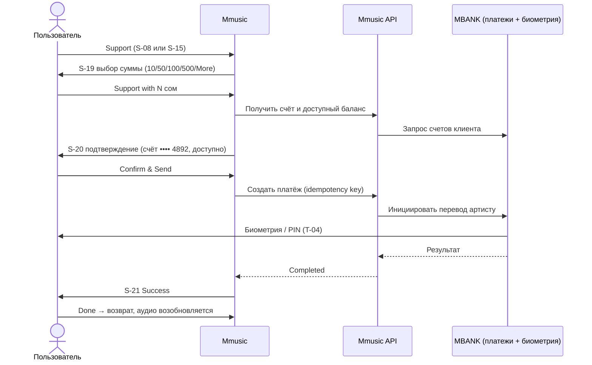
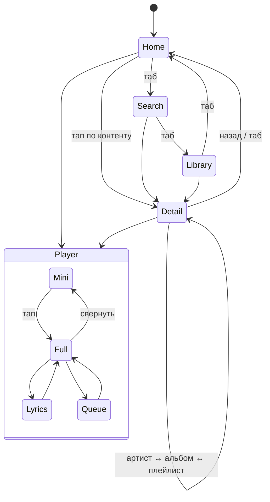
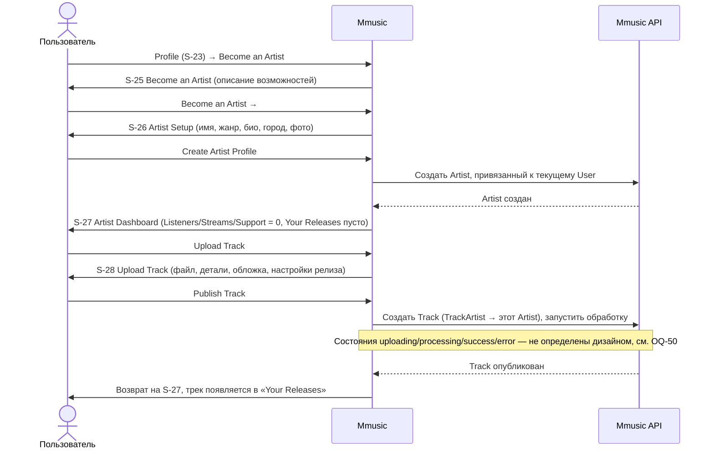

# Пользовательские сценарии — Mmusic

> Раздел 5 ТЗ. ID экранов (S-NN, T-NN) — по `docs/screens.md`. Метки: [Д] дизайн, [П] предложение, [Т] технически необходимо.

## UF-01 Пользователь открывает приложение
1. Запуск → Splash (T-01) [Т].
2. Проверка сессии:
   - есть действующий токен → шаг 3;
   - нет токена → вход через MBANK (T-02, OQ-07) → шаг 3.
3. Открывается **Home** (S-01) [Д]: секции загружаются параллельно (скелетоны [Т]).
4. Если в прошлой сессии что-то играло — мини-плеер показывает последний трек на паузе [П].
- **Ошибка:** нет сети → офлайн-баннер; при наличии загрузок предлагается Library → Downloaded [П].

## UF-02 Дискавери музыки
1. Home → пролистывает «For you», «Trending Now», «New Releases», «Mood & Vibe Mixes» [Д].
2. Тап «See All» у Trending / New Releases → **S-02**, переключает фильтры This Week / Top Charts / Albums / Singles [Д].
3. Или: вкладка **Search** (S-03) → «Browse All» → жанр (например, Kyrgyz Music) → **S-07** [Д].
4. Или: S-05 «Explore All Genres» → **S-06** → «Curated Realm» → **S-07** [Д].
5. На странице жанра: Listen Now (воспроизведение), Follow (подписка на жанр), переход к подборке или артисту [Д].

## UF-03 Поиск трека
1. Вкладка **Search** (S-03) → тап в поле [Д].
2. Ввод запроса → через debounce появляется **S-04** с секциями Top Result / Songs / Artists / Albums / Playlists [Д].
3. При необходимости — фильтр Songs [Д].
4. Тап по треку → воспроизведение; мини-плеер появляется или обновляется [Д].
5. Запрос сохраняется в «Recent Searches» [Д].
- **Альтернатива:** тап по чипу недавнего или трендового запроса → сразу S-04 [Д].
- **Пусто:** 0 результатов → **S-05** → «Explore All Genres» или трендовый чип [Д].
- **Ошибка:** сеть или сервер → сообщение с «Повторить» [Т].

## UF-04 Открытие артиста или альбома
1. Из поиска, Home, жанра или плеера (тап по имени артиста) → **S-08 Artist** [Д].
2. Действия на S-08: Follow, Play (весь Top), Shuffle, Popular → трек, Releases → **S-09 Album**, Fans Also Like → другой артист, Support → UF-10 [Д].
3. На **S-09**: Play / Shuffle, ♥ Save (альбом попадает в Library), Download, тап по треку → воспроизведение с этой позиции [Д].

## UF-05 Воспроизведение музыки
1. Тап по треку или кнопке Play в любом списке → очередь формируется из контекста (альбом, плейлист, результаты) [П].
2. Мини-плеер показывает трек, прогресс и Play/Pause [Д].
3. Тап по мини-плееру → **S-15 Now Playing** [Д].
4. На S-15: Pause/Play, Next/Prev, перемотка, Shuffle, Repeat, ♥ [Д].
5. Lyrics → **S-16** (синхронный текст) [Д]; Queue → **S-17** (перестановка, Infinity Autoplay) [Д].
6. Свернуть (˅) → мини-плеер, навигация продолжается [Д].
7. Приложение свёрнуто или экран заблокирован → воспроизведение продолжается, работают системные контролы [Т].
- **Ошибка:** трек недоступен → тост, переход к следующему [Т]; буферизация → индикатор [Т].

## UF-06 Сохранение трека (лайк)
1. ♥ на строке трека, в мини-плеере, в плеере или в очереди [Д].
2. Сердце мгновенно заполняется (оптимистичное обновление) [П]; запрос на сервер.
3. Трек появляется в **Library → Liked Songs (S-13)** [Д].
4. Повторный тап → лайк снимается, трек исчезает из Liked Songs [Д].
- **Ошибка:** запрос не прошёл → откат состояния и тост [Т].

## UF-07 Добавление трека в плейлист
1. «⋮» на треке → меню трека → «Add to playlist», или «⋯» в плеере [Д].
2. Открывается шторка **S-18** [Д].
3. Пользователь отмечает один или несколько плейлистов (+ → ✓), видит тост «Added to …» [Д].
4. При необходимости ищет плейлист в поле «Find a playlist…» [Д].
5. Done → шторка закрывается [Д].
- **Альтернатива:** «New Playlist» → создание (UF-08), текущий трек добавляется автоматически [Д].

## UF-08 Создание плейлиста
1. Library → «+» [Д] (или New Playlist в S-18).
2. Открывается **S-14** (или модалка «New Playlist» — OQ-19).
3. Пользователь задаёт обложку (фото / AI Generate / Color Wave), название (≤ 50), описание, Public и Collaborative [Д].
4. Create → плейлист создан → открывается его страница (S-10) [П] и он появляется в Library [Д].
- **Валидация:** пустое имя → Create неактивна [Д].

## UF-09 Использование плейлистов и библиотеки
1. Вкладка **Library** (S-12) → Liked Songs закреплены сверху [Д].
2. Фильтр (Playlists / Artists / Albums / Downloaded), сортировка, поиск [Д].
3. Тап по плейлисту → S-10 / S-11 → Play All / Shuffle / Sort / Find in playlist [Д].
4. Тап по артисту → S-08; по альбому → S-09 [Д].

## UF-10 Поддержка артиста (донат) [Д]

1. Точка входа: «Support» на странице артиста (S-08) или во вкладке плеера (S-15).
2. **S-19:** выбор суммы; «More» → ввод своей суммы (T-03).
3. **S-20:** проверка суммы и счёта → Confirm & Send.
4. Биометрическое подтверждение банком (T-04).
5. **S-21:** успех → Done (возврат и возобновление аудио) или «View Support Receipt in History» → S-22.
- **Ошибки [Т, OQ-14]:** недостаточно средств — сообщение на S-20; отказ банка или таймаут — экран ошибки с повтором без двойного списания; биометрия отменена — возврат на S-20.

## UF-11 Просмотр истории поддержки
1. Profile (S-23) → Support History, или S-21 → ссылка [Д].
2. **S-22:** итог, фильтры All / This Month / Top Supported / Receipts, группы по датам [Д].
3. Тап по карточке → детали или квитанция (экран не задизайнен — OQ-16); тап по имени → артист [Д].

## UF-12 Профиль и настройки
1. Вход в профиль (OQ-17; [П] — аватар в шапке) → **S-23** [Д].
2. Просмотр статистики и «Listening Pulse» [Д].
3. Audio Quality & Playback → **S-24**: Lossless, качество, Crossfade, Gapless, Normalization [Д].
4. Log Out → подтверждение [П] → очистка сессии → T-02 [Т].

## UF-13 Навигация между Home, Search, Library и плеером

- Мини-плеер сохраняется при переходе между вкладками [Д].
- Каждая вкладка хранит свой стек; повторный тап по вкладке → корень [П].
- Системная «назад» (Android) закрывает шторку → плеер → экран стека [Т].

## UF-14 Стать артистом и опубликовать трек [Д, добавлено 2026-10-06]

1. Точка входа: **Profile Hub (S-23)** → пункт «Become an Artist» в «Studio Sanctuary» [Д].
2. **S-25:** витрина возможностей (загрузка треков, поддержка фанатов, аналитика) → «Become an Artist».
3. **S-26:** заполнение профиля артиста (сценическое имя, основной жанр, короткое био, город, фото) → «Create Artist Profile».
4. Создаётся **Artist**, привязанный к текущему **User** 1:1 — это **та же сущность**, что отображается публично на **S-08 Artist Profile**; дублирования артистов не создаётся (решение пользователя, 2026-10-06).
5. **S-27 Artist Dashboard:** сводка (Listeners / Streams / Support) и список «Your Releases» (переиспользует Track row) → «Upload Track».
6. **S-28:** загрузка аудиофайла, заполнение названия/жанра/обложки, настройка релиза (сейчас / по расписанию), пометка Explicit → «Publish Track» или «Save as Draft».
7. Опубликованный трек использует **существующую модель Track/Album/TrackArtist** (architecture.md §6) и появляется в обычном каталоге, поиске, на S-08/S-09, доступен для воспроизведения через существующий плеер — отдельного «артистового» плеера или каталога не вводится (решение пользователя, 2026-10-06).
- **Навигация:** S-25…S-28 — обычные экраны в стеке (кнопка «назад»), основной таб-бар (Home / Search / Library) и мини-плеер не заменяются отдельным таб-баром кабинета артиста (решение пользователя, 2026-10-06; подробнее — `docs/screens.md` §1).
- **Не определено дизайном [Т, OQ-50]:** что видит пользователь во время загрузки/транскодирования, при ошибке формата или сети, и куда ведёт «Save as Draft».
- **Не определено дизайном [Т, OQ-48, OQ-49]:** привязка счёта MBANK для выплат (нужна для будущих донатов артисту, UF-10) и верификация/модерация артиста — в S-26 нет соответствующего шага.
- **Вне скоупа этой фазы:** аналитика по трекам, платное продвижение, тарифы/подписки артиста (экраны `mmusic_studio`, `mmusic_boost`, `midnight_mirage` — см. `docs/screens.md` §0).
